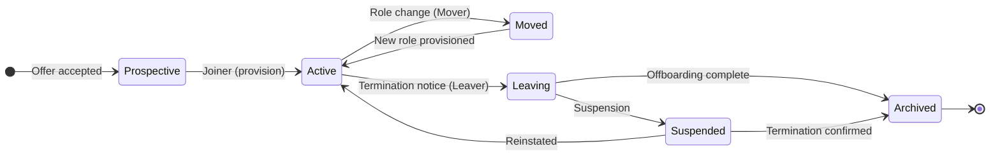

# Identity Lifecycle (Joiner, Mover, Leaver)

Identity records are not static. A person joins, changes role, and eventually leaves, and each transition changes what access they should hold. The lifecycle model names those transitions and defines what must happen at each one. In practice it is usually summarized as JML: **Joiner**, **Mover**, **Leaver**.

## Joiner: provision for the role, not the person

When a person joins, their identity is created and provisioned with the access their role requires. Two failure patterns dominate this stage:

- **Over-provisioning on day one.** The classic approach of "give them everything their predecessor had" creates standing access nobody reviewed. Provision from the role, not from a copy of another person's entitlements.
- **Manual provisioning.** When accounts are created by hand per system, consistency depends on whoever happened to be on duty. Automation (through provisioning tools and, ideally, SCIM; see [Identity Protocols & IGA](../protocols-iga/index.md)) makes the joiner path repeatable and testable.

Good joiner practice includes a defined start date, a pre-approved access plan based on the role, and a verification step that the account actually works before the person needs it.

## Mover: access follows the role, and leaves the old one

Role changes are where access decay begins. When someone moves from one department to another, the common failure is adding new access without removing the old. The result is a person whose entitlements are the union of every role they have ever held, which is exactly the accumulation problem IAM exists to prevent.

The mover process should:

- Re-run the provisioning decision for the new role.
- Remove entitlements that belong to the old role and are not justified by the new one.
- Re-run segregation-of-duties checks, because a move can create conflicting combinations (for example, someone who now approves their own requests).
- Record the change for audit and for the next access review.

Access reviews are the safety net for mover failures. If entitlements silently persist, a periodic certification process is what catches them.

## Leaver: the highest-risk transition

Termination is where lifecycle hygiene pays for itself. A departed employee's account is a standing credential that nobody is using and that often still has access to sensitive systems. Delays in offboarding are a direct source of insider risk and of audit findings.

The leaver process should cover:

- **Account disablement** at the point of termination, ideally automated and immediate, including service accounts tied to the person.
- **Credential invalidation**: passwords, sessions, tokens, and any enrolled devices.
- **Data handling**: handover of work files, transfer of owned resources, and access to personal records per policy.
- **Suspension as a middle state** for contested departures or where a notice period applies.
- **Archive and deletion** on a defined schedule, with records retained per retention policy for audit.

Two timing decisions matter: how fast accounts are disabled (immediate is the only defensible default) and how long archives are retained (retention is a legal and audit question, not a storage one).

## Why lifecycle determines risk

Almost every access problem in mature organizations traces back to lifecycle drift: orphaned accounts, stale entitlements, and roles that survived their purpose. The lifecycle is the process that keeps the identity directory honest, and most of the automation in IAM products exists to make these transitions fast and consistent rather than dependent on human diligence.

Next: [least privilege and zero trust](04-least-privilege-zero-trust.md), the principles that decide how much access anyone should hold at any moment.