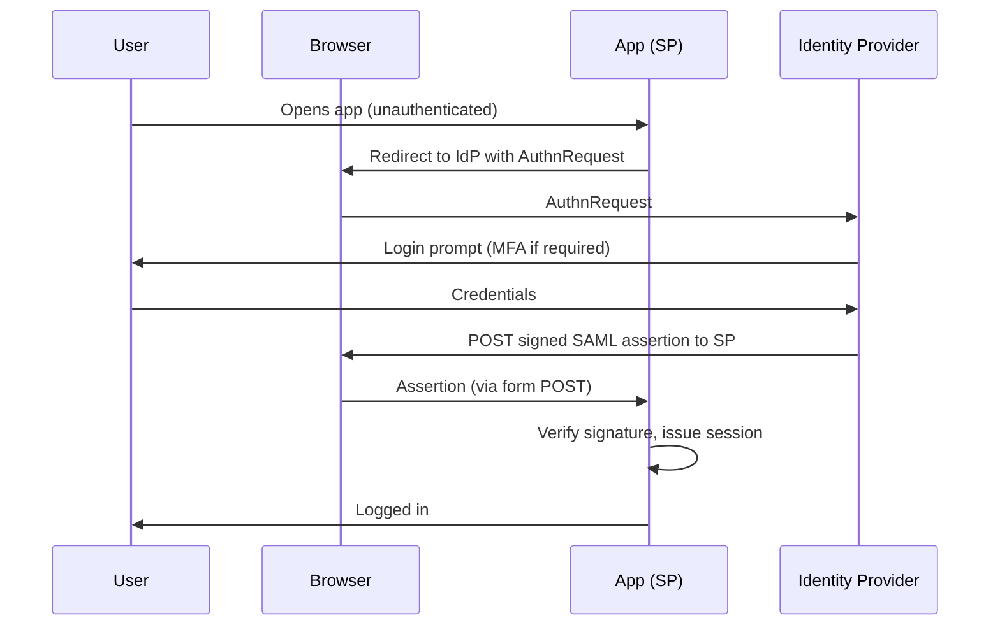

# SAML

Security Assertion Markup Language (SAML) is the SSO protocol of the enterprise: it is how a user logs in once at a central identity provider and gets into applications without presenting credentials again. It is XML-based, predates OIDC, and remains the default integration protocol for SaaS applications and government/education federations.

## The model: SP and IdP

SAML has two roles:

- **Identity Provider (IdP)**. Authenticates the user and issues assertions about them.
- **Service Provider (SP)**. The application the user wants to reach; trusts the IdP and consumes its assertions.

The two trust each other through metadata: each side publishes its certificates and endpoints, and each verifies the other's signatures. No shared session state exists; trust is cryptographic and configured up front.

## The flow: SP-initiated SSO

*SP-initiated SSO. The user is redirected to the IdP, authenticates, and the IdP returns a signed assertion that the application verifies before creating a session.*

The assertion carries identity claims: who the user is (NameID), what attributes they have (groups, mail), and conditions such as validity window and audience (which SP the assertion is for). The audience restriction matters: an assertion issued for one application must be worthless at another.

## IdP-initiated versus SP-initiated

- **SP-initiated** starts at the application and redirects to the IdP. Used for most user-facing apps.
- **IdP-initiated** starts at the IdP portal ("choose an app") and sends the user to the SP already authenticated. This is the pattern of app launcher pages. It carries a known risk: the SP receives an unsolicited assertion, so session fixation protection matters there.

## What can go wrong

SAML is powerful and unforgiving:

- **Signature verification gaps.** An SP that does not actually verify the assertion signature (or checks only the XML body, not the whole signed element) accepts forged assertions. XML signature wrapping attacks are the classic exploit; the correct answer is strict schema validation plus full-document signature verification.
- **NameID confusion.** If the IdP changes the NameID format or value (from email to a directory GUID), every SP silently starts creating new identities, which cascades into orphaned accounts and access reviews gone wrong.
- **Certificate lifecycle.** IdP signing certificates expire and rotate. SPs that hardcode the old certificate break at rotation time; the metadata-based trust relationship exists precisely to handle this gracefully.
- **Session lifetime mismatch.** The IdP session and the SP session are independent. Revoking at the IdP does not kill existing SP sessions unless single logout is implemented and honored.

## SAML versus OIDC

| | SAML | OIDC |
|---|---|---|
| Era and transport | XML over browser redirects and POSTs | JSON over HTTP, OAuth 2.0 underlay |
| Token | Signed XML assertion | Signed JWT ID token |
| Best fit | Enterprise SaaS, government/edu federations, legacy stacks | Web/mobile apps, APIs, cloud-native |
| Complexity | High (XML parsing, metadata exchange) | Lower (JSON, discovery document) |

The pragmatic rule most identity teams use: SAML where the vendor ecosystem expects it (Microsoft 365, Salesforce, most SaaS catalogs support both, but SAML is the safe common denominator), OIDC where the stack is modern or APIs are involved. Both give the same guarantee: one authentication at the IdP, verified trust into the application.

Next: [OAuth 2.0](03-oauth2.md), the authorization framework that OIDC builds on, and the grant types that move tokens instead of assertions.