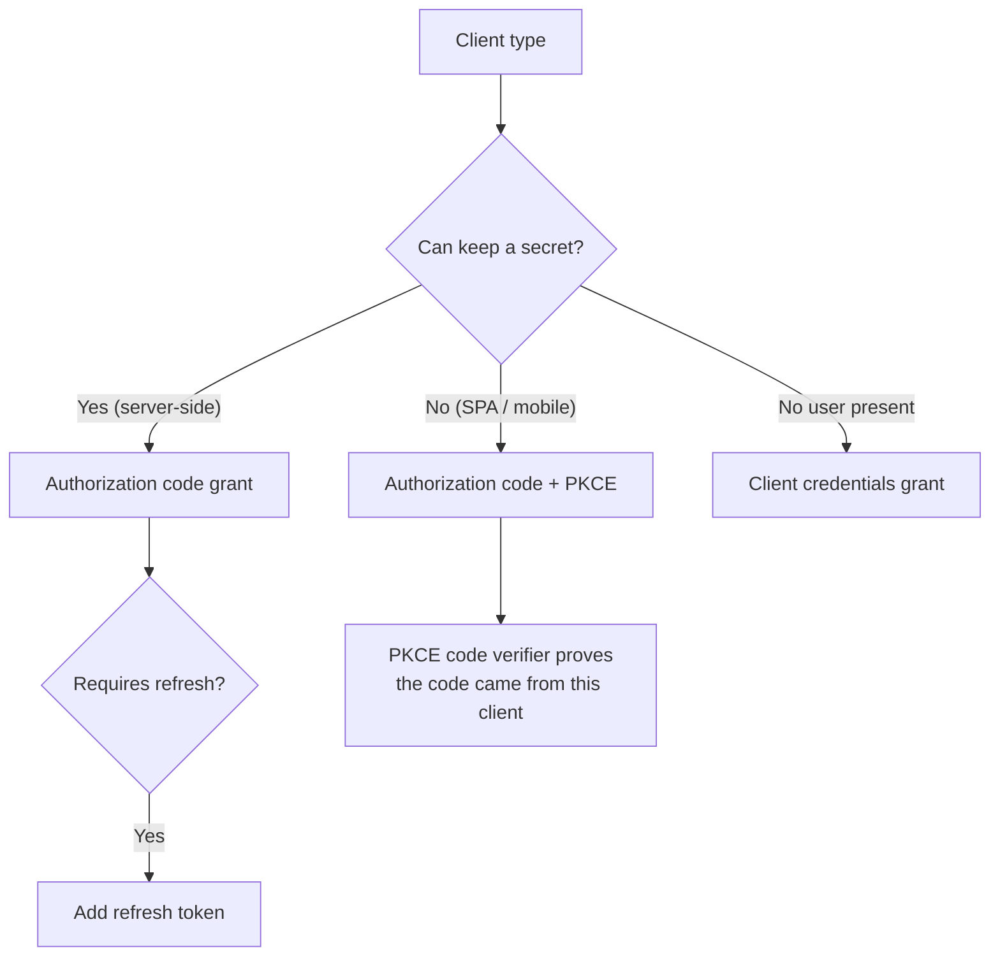

# OAuth 2.0

OAuth 2.0 is the authorization framework that lets an application obtain limited access to a user's data on another service, without the user handing that application their password. It is not an authentication protocol: it issues *access* tokens, not proof of identity. The identity layer on top of it is [OpenID Connect](04-oidc.md).

## The cast

| Role | What it is |
|---|---|
| Resource owner | The user who owns the data |
| Client | The application asking for access |
| Authorization server | Issues tokens; in IAM terms, the IdP's token service |
| Resource server | Serves the protected data; validates the access token |

The framework's core statement is that the client never sees the user's password. Instead it receives a token carrying a scope: a bounded, named set of permissions ("read:calendar", "write:docs"). The user's consent plus the scope define exactly how far the token reaches.

## The grants

Different client types need different ways of getting a token. The grant type is chosen by who holds secrets and where code runs:

*Grant selection: the shape of the flow follows from whether the client can protect a secret, whether a user is present, and whether long-lived access is needed.*

- **Authorization code.** The user authenticates at the authorization server, the server returns a short-lived code to the client's redirect URI, and the client exchanges the code (with its secret) for tokens at the token endpoint. This is the workhorse flow.
- **Authorization code + PKCE.** Same flow, with a proof key: the client generates a random verifier, sends its hash at the start, and proves possession of the verifier when exchanging the code. PKCE makes the code useless to anyone who intercepts it, and it is now recommended for every client type, not just public ones.
- **Client credentials.** Machine to machine: the client authenticates with its own secret (or mTLS certificate) and receives a token scoped to its own permissions. No user involved.
- **Device flow.** For TVs and CLI tools: the user authorizes on another device by entering a short code.

## Tokens and their lifetimes

- **Access token.** Presented to the resource server; short-lived (minutes to an hour). Modern practice uses JWTs so resource servers can validate the token locally without calling back to the authorization server.
- **Refresh token.** Long-lived and used only against the token endpoint to mint new access tokens. Because it can mint tokens for a long time, it must be stored carefully (server-side, encrypted) and rotated on each use; a stolen refresh token is the point of maximum damage in an OAuth deployment.
- **Scopes** bound what the token can do. Scopes are the authorization discipline of OAuth: coarse tokens and long lifetimes are the two classic misconfigurations.

## The security rules

- **Never log tokens.** Access tokens and refresh tokens in application logs turn logging into a credential store.
- **Validate redirect URIs exactly.** An attacker who can steer the authorization code to their own URI has stolen the code; exact-match allowlists are mandatory.
- **Bind tokens to clients.** Confidential clients must authenticate at the token endpoint; public clients must use PKCE.
- **Rotate refresh tokens.** One-time use with rotation means a stolen refresh token fails on its first replay, and the replay itself is a detection signal.
- **Shorten access tokens.** A JWT access token cannot be revoked before expiry unless the resource server checks a revocation list, so the token lifetime is your revocation window.

## OAuth is not SSO

An OAuth access token proves "this client has scope X on resource Y." It does not prove who the user is, and a resource server that treats a scope as an identity is repeating the classic confusion. Identity on top of OAuth is the job of OIDC, which adds the ID token and the UserInfo endpoint.

Next: [OpenID Connect](04-oidc.md), the identity layer that turns OAuth 2.0 into a usable SSO protocol.

## Edge cases and protocol decisions

The grant selection chart above is the common case. The decisions that separate experienced practitioners:

- **PKCE is not optional for any public client.** The authorization code grant without PKCE is vulnerable to code interception on mobile and desktop apps. Every OAuth library built after 2020 supports PKCE; if yours does not, replace it.
- **Refresh tokens for public clients are a design tension.** A refresh token on a browser or mobile app can be exfiltrated with the same effort as an access token. The current pattern for SPAs is the BFF (Backend for Frontend) pattern: the SPA talks to a thin backend server that holds the refresh token and issues session cookies. The SPA never sees the refresh token.
- **The "audience" problem:** an access token issued for API A can be presented to API B if API B does not validate the `aud` claim. The validation is the resource server's responsibility; the authorization server cannot enforce it. Every resource server must check `aud` against its own identifier.
- **Token exchange (RFC 8693):** when a service needs to call another service on behalf of the user, the naive pattern is to forward the original access token (wrong: wrong audience, wrong scope, no delegation chain). The correct pattern is token exchange: the calling service exchanges the original token for a new one scoped to the downstream service, with the delegation chain preserved.
- **Sender-constrained tokens (mTLS bound or DPoP):** a bearer token stolen from logs or memory can be used by anyone. Sender-constrained tokens bind the token to the client's TLS certificate or a proof-of-possession key, so a stolen token is useless without the bound credential. This is the direction the ecosystem is moving for high-security clients.

**What breaks without these:** an OAuth deployment that only implements the happy-path authorization code flow and stops is the most common source of OAuth vulnerabilities in the wild. The edge cases above are not advanced; they are the baseline for a production deployment in 2026.