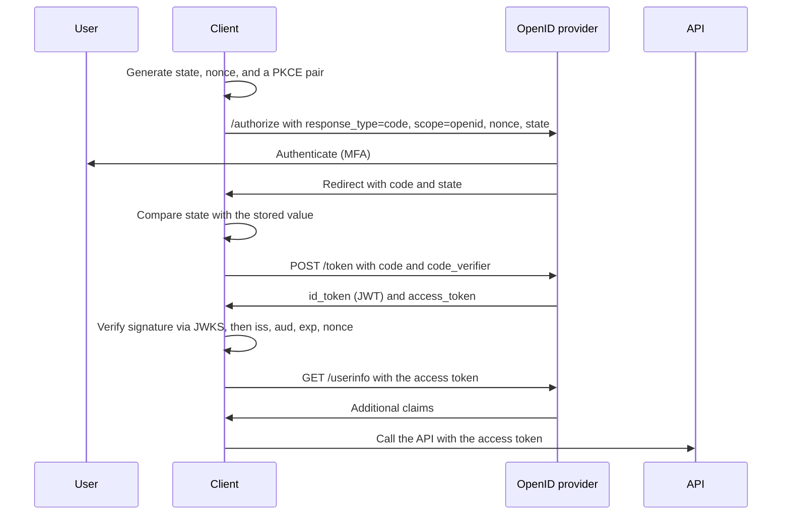

# OpenID Connect (OIDC)

OpenID Connect (OIDC) is the identity layer built on top of OAuth 2.0. OAuth 2.0 moves tokens for delegated authorization; OIDC adds a signed ID token that carries identity claims, plus the machinery to discover and validate it. Where SAML is the enterprise SSO standard, OIDC is the modern one: it is what most cloud-native apps, mobile apps, and API-first stacks use for login.

## OIDC is OAuth with identity on top

The relationship is deliberately layered: everything OIDC does for the login flow is an OAuth 2.0 flow, with additional identity artifacts on top.

import Drawio from '@site/src/components/Drawio';
import oidc from '!!raw-loader!@site/static/diagrams/oidc-on-oauth.drawio';

<Drawio content={oidc} />

*OIDC reuses the OAuth 2.0 authorization framework unchanged and adds the ID token, the UserInfo endpoint, and discovery on top. The lower layer stays a pure authorization framework; the upper layer is where identity appears.*

<a href="/diagrams/oidc-on-oauth.drawio" download>Download / edit this diagram</a>

## The ID token

The ID token is the heart of OIDC: a signed JWT issued by the IdP to the client at the end of the authentication flow, carrying identity claims:

| Claim | Meaning |
|---|---|
| `sub` | Stable subject identifier (never the email, which can change) |
| `iss` | Issuer: which IdP issued the token |
| `aud` | Audience: which client the token was issued for |
| `exp` / `iat` / `nbf` | Validity window |
| `nonce` | Replay protection bound to the original request |
| `email`, `name`, `groups`, `roles` | Identity and entitlement claims (depending on scope) |

The client validates the signature (using the IdP's keys discovered below), checks issuer, audience, and expiry, and then owns an identity it can trust without a second network call. The claims are only as good as what the IdP publishes: a `roles` claim in the token makes the IdP the authorization source of truth, which is convenient and also a target for attackers who compromise the IdP.

## The sign-in sequence

OIDC adds identity to the authorization code flow. The messages are the ones OAuth already defines; what changes is the `openid` scope, the ID token in the token response, and the nonce that ties the token to this request.

*OIDC sign-in. The ID token says who the user is and is validated by the client; the access token says what the client may call and is validated by the API. Neither token substitutes for the other.*

The split matters in practice. An API that accepts an ID token as a bearer credential is accepting a token minted for a different audience, which is the OIDC version of the OAuth audience mistake. The nonce check is what makes a replayed ID token fail, and the JWKS fetch is what lets the IdP rotate signing keys without breaking every client at once.

## Discovery and dynamic registration

OIDC solved SAML's metadata friction with a standard discovery document: fetching `/.well-known/openid-configuration` from the issuer returns its authorization, token, and UserInfo endpoints plus its signing keys (via JWKS). A client can bootstrap the entire trust relationship from the issuer URL alone, and key rotation is handled by republishing the key set, which is why OIDC integrations rarely break on certificate rotation the way SAML ones do.

## Choosing between SAML and OIDC

The decision table from the [SAML page](02-saml.md) applies, with one refinement: where both are supported, most identity teams pick OIDC for new integrations (JSON, simpler validation, discovery, natural fit for APIs and SPAs) and keep SAML where the ecosystem or regulatory context expects it (many SaaS catalogs, government federations, older vendor stacks). The two coexist in the same IdP without conflict, which is exactly what the [complete IAM architecture](07-iam-architecture.md) shows: the IdP speaks both, and each application connects through whichever its vendor supports.

## OIDC in the IAM stack

For the IAM practitioner, OIDC shows up in four places: application login (SPA and mobile via authorization code with PKCE), API access (access token scoped for the resource server), machine-to-machine service accounts (client credentials), and as the modern replacement for the LDAP-bind-era application integrations. Each use has the same discipline attached: shortest reasonable token lifetime, exact redirect URI validation, refresh token rotation, and scopes that say what they mean.

Next: [SCIM](05-scim.md), the provisioning protocol that keeps the accounts behind these logins in sync.