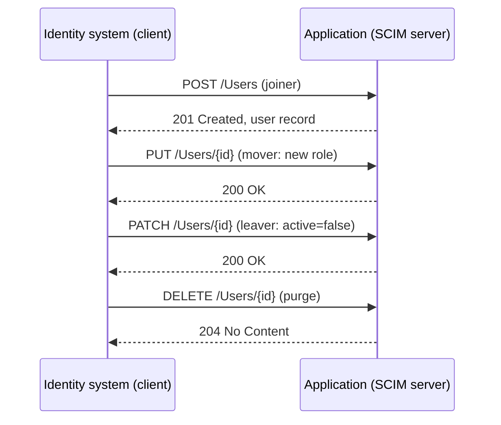

# SCIM

System for Cross-domain Identity Management (SCIM) is the provisioning protocol: the mechanism that creates, updates, and deactivates user records in applications automatically, instead of by a human clicking through an admin panel. Every page on this site that mentions automation in the [identity lifecycle](../fundamentals/03-identity-lifecycle.md) is implicitly about SCIM, because SCIM is how joiner, mover, and leaver events actually reach the applications.

## Why provisioning needs a protocol

Without SCIM, every application integration is custom: the IdP or IGA product vendors a connector for each target, each with its own quirks, and the connector estate is where provisioning quality silently rots. With SCIM, the target application exposes a standard API, and the identity system speaks one protocol to everything that supports it.

## The model

SCIM is a REST API with a JSON schema and a small set of resource types. The core resource is the user; groups and entitlements extend it.

*The lifecycle events map directly to CRUD operations: create on join, update on role change, deactivate on leave, delete on purge. Idempotency matters: the identity system must be able to retry any call safely.*

## The operations and their IAM meaning

| Operation | Lifecycle event | Notes |
|---|---|---|
| `POST /Users` | Joiner | Idempotent creation keyed on `userName` or external ID |
| `PUT` / `PATCH /Users/{id}` | Mover | Full replace vs partial update; PATCH is the standard for small changes |
| `PATCH` with `active=false` | Leaver | Deactivate, do not delete: the account exists for audit but cannot authenticate |
| `DELETE /Users/{id}` | Purge | After retention; delete cascades through group memberships |
| `GET /Groups`, `PATCH /Groups` | Group sync | Group membership is how most apps map to roles |

The design has two properties that make it production-viable: **idempotency** (retrying a create does not duplicate the user) and **external identity** (the `externalId` ties the application's record to the source system's ID, so reconnects and resyncs do not fork records).

## Practical pitfalls

- **Partial schema coverage.** Every application implements a subset of the schema. The integration contract is the attribute mapping table, and it should be written down, because the mapping is what breaks when the HR source adds a field.
- **Attribute mapping is authorization-relevant.** If a user's department or group membership fails to sync, the application's authorization decision is made against stale data. SCIM sync health is therefore an access control control, not a plumbing concern.
- **Bulk and pagination.** Initial provisioning of a large user base uses `GET /Users` with pagination and filters; bad pagination support in the target is a classic blocker for cutover.
- **Sync loop risk.** If two systems provision each other (HR system to IdP, IdP to app), a failure to deduplicate by externalId creates loops or duplicated records. One authoritative source per attribute is the rule.

## Where SCIM sits

SCIM is the write side of the identity stack, the counterpart to the read side (LDAP) and the login side (SAML/OIDC). An application's integration story is complete when it can be *read* (LDAP or API), *logged into* (SAML/OIDC), and *provisioned* (SCIM). That triad is the checklist for assessing any new SaaS integration, and it is exactly the shape of the [complete IAM architecture](07-iam-architecture.md) diagram's provisioning path.

Next: [Identity Governance & Administration](06-iga.md), the layer that decides what SCIM should provision in the first place.