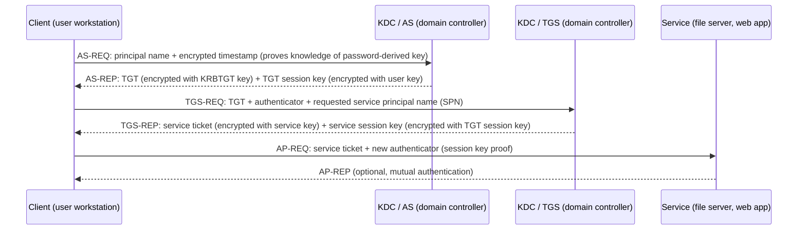

<!-- verified 2026-08-19: Kerberos protocol exchange and Windows defaults (TGT lifetime 10h, KRBTGT account, UDP/TCP 88) verified against Microsoft's Kerberos documentation. -->

# Kerberos and Windows Authentication

Active Directory is the most common identity store on this site's lab path, and the protocol that actually authenticates users in an AD domain is Kerberos, not LDAP. LDAP is how applications *read* the directory (see [LDAP](01-ldap.md)); Kerberos is how a user proves their identity to a service without sending a password over the wire. If you understand the ticket exchange below, you understand Windows single sign-on, and you understand why attacks like Kerberoasting and golden tickets exist.

## The players

- **Principal**: an identity known to the Kerberos domain, either a user (`alice@CORP.LOCAL`) or a service (`HTTP/web01.corp.local`). Every principal has a secret derived from its password.
- **KDC (Key Distribution Center)**: the service that issues tickets. In Active Directory, every domain controller runs the KDC (port 88, UDP and TCP).
- **KRBTGT account**: the domain account whose password-derived key encrypts every ticket-granting ticket. Its hash is the crown jewel of a domain (see [attacks](#attacks-on-kerberos) below).
- **TGT (ticket-granting ticket)**: proof that the user authenticated to the domain, encrypted with the KRBTGT key, valid by default for 10 hours in AD.
- **Service ticket**: proof that the user may talk to one specific service, encrypted with that service's key.
- **Authenticator**: a short-lived timestamp encrypted with the session key, proving the presenter actually holds the session key right now.

## The ticket exchange

The flow has four messages across three legs: ask the KDC for a TGT, ask the KDC for a service ticket, then present the service ticket to the service.

Read it as: the user proves their password once (AS leg), the KDC vouches for them for the rest of the day (TGT), and each service trusts the KDC's signature on its own ticket (service leg). The service never sees the user's password, and the user's password-derived key is only used on the first leg, which is why single sign-on works: the TGT in the session cache (and the TGT session key) replaces the password for subsequent service requests.

Two details worth knowing:

- **Clock skew**: tickets carry timestamps, so clients and KDCs must be time-synced (AD enforces a default skew tolerance of 5 minutes). The classic "kerberos has a time skew" error is a time problem, not an auth problem.
- **Renewal**: when a TGT expires, the client silently repeats the AS leg with the stored password hash; the user never notices. This is why changing a password (or the machine being offline) breaks existing sessions in odd ways.

## NTLM: the fallback and its cost

NTLM is the older Windows authentication protocol that survives as a fallback for legacy scenarios: local logon, workgroup machines, and applications that never learned Kerberos. It is weaker in two structural ways:

- **No mutual authentication**: the client proves knowledge of the password hash (actually the NT hash) to the server, but the server does not cryptographically prove itself to the client. A rogue server can capture an NTLM exchange.
- **Pass-the-hash**: the protocol is built on the NT hash, not the password. Anyone holding the hash can authenticate as that user without the password, and the hash is present on the machine that did the logon. Kerberoasting-style offline attacks and lateral movement tools exploit exactly this property.

Enterprises routinely disable NTLM where Kerberos covers the workload (Group Policy can restrict it to specific servers) and treat "NTLM auth allowed" as a finding in architecture reviews. If an application cannot do Kerberos, the standard answer is a service account scoped to that app, not a standing exception for everything.

## Delegation

Kerberos delegation lets a service act on the user's behalf when it needs to reach a downstream service, which is how multi-tier applications flow identity from web tier to database tier.

- **Unconstrained delegation**: the service receives the user's TGT and can impersonate the user anywhere. Powerful and dangerous; an attacker who compromises the service gets the TGTs of every user who used it.
- **Constrained delegation**: the service can impersonate the user only for specific service principal names. Still powerful, but the blast radius is explicit.
- **Resource-based constrained delegation**: the *target* service declares which accounts may impersonate users to it, which moves control closer to the resource owner. Microsoft has pushed this direction since it limits what an attacker gains from a single compromise.

The practical consequence for IAM: delegation settings are privileged attributes of machine accounts and should be reviewed like any other privileged entitlement (see [Privileged Account Types](../pam-core/02-privileged-account-types.md)). In interviews, "how do you scope delegation" is a proxy question for "do you understand that identity flows across tiers".

## Attacks on Kerberos

| Attack | How it works | Why it succeeds | Defense |
|--------|--------------|-----------------|---------|
| Kerberoasting | Request a service ticket for a SPN with a weak password, then crack the ticket offline (the ticket is encrypted with the service key) | Service accounts with human-grade passwords and no rotation | Strong unique service account passwords, managed rotation (CPM-style), auditing SPN accounts, hunting tickets with AES encryption requested |
| Golden ticket | Forge a TGT using the KRBTGT hash | The KRBTGT key is static; domain controllers trust any TGT they can decrypt | Protect KRBTGT (break-glass tier 0), rotate it on compromise, monitor anomalous TGT issuance |
| Silver ticket | Forge a service ticket with the compromised service account's key | Service tickets are signed with the service key, not validated per request | Service account hygiene, monitoring service ticket anomalies, (same defense family as Kerberoasting) |
| Pass-the-hash | Authenticate as a user using only the NT hash, no password | NTLM trusts the hash; hashes sit on machines after logon | Disable NTLM where possible, Local Security Authority protection, credential guard, limit admin rights on workstations |
| Pass-the-ticket | Replay a captured TGT or service ticket from another machine | Tickets are valid until expiry regardless of originating machine | Shorter ticket lifetimes, disable unconstrained delegation, monitor for unusual ticket usage |
| DCSync | Request directory replication from a domain controller using DRSUAPI, pulling password hashes including KRBTGT | Replication is a legitimate domain function; domain admins can invoke it | Tier 0 hygiene: domain admin accounts only on domain controllers, monitor DRSUAPI calls (event 4662), never run DA sessions on workstations |
| Overpass-the-hash | Convert an NT hash into a Kerberos TGT, then use Kerberos normally | Kerberos AS-REQ with RC4 key can start from the hash alone | Enforce AES-only Kerberos encryption, disable RC4, monitor for RC4 AS-REQ |

The pattern across all of them: Kerberos is safe *if* keys stay secret and ticket lifetimes stay bounded. Every attack above is an attack on a key or a ticket, which is why the defensive answer is always the same family: tiered administration, managed service account rotation, AES-only encryption, and monitoring. Those are PAM controls, and they are covered in detail on [PAM Best Practices](../pam-core/04-best-practices.md) and the [Lab: AD + Keycloak SSO](../labs/02-keycloak-sso.md) page, where the KRBTGT and service-account concepts appear in a live directory.

## Interview angle

Two questions dominate: "explain how SSO works" and "what happens when Kerberos fails". The first is the ticket exchange above, told in two minutes: password proves identity once, the TGT proves it all day, each service trusts the KDC's encryption. The second is usually one of: clock skew (time), SPN mismatch (the service name in the ticket does not match what the client requested), missing or stale keytab (the service cannot decrypt its tickets), or the service account password changed and the machine did not update. Those four causes cover most real-world Kerberos breakage, and each has a concrete fix.

## Detection signals in the wild

The Kerberos exchange is textbook. The detection work is recognizing when the exchange is being abused:

- **RC4 tickets in an AES-only environment.** If the domain is configured to refuse RC4, any RC4 ticket is either a legacy system that was not migrated (track it down) or an attacker downgrading the encryption to crack the ticket offline (Kerberoasting with RC4 is orders of magnitude faster than AES).
- **TGT lifetime anomalies.** A TGT that lasts longer than the domain default (10 hours) is either a golden ticket or a misconfigured policy. The `TicketOptions` field in the 4768 event encodes the requested lifetime; flag anything above the default.
- **Pre-authentication disabled.** The `UF_DONT_REQUIRE_PREAUTH` flag on a user account lets an attacker request a ticket without knowing the password and crack it offline. The 4768 event without pre-auth is the signal. The accounts that legitimately need this flag (rare) should be in a dedicated OU and monitored separately.
- **Service ticket volume spikes.** A sudden increase in 4769 events to a single SPN is a Kerberoasting attack: the attacker is requesting service tickets for offline cracking. The signal is volume, not success or failure.
- **DRSUAPI from non-domain controllers.** The 4662 event with the DRSUAPI replication GUID is a DCSync attack: an attacker is requesting directory replication to extract password hashes. The source computer in the event should always be a domain controller.

**What breaks without these:** an attacker who Kerberoasts a service account and cracks the password offline produces no failed logins, no account lockouts, and no obvious signal. The only detection is the 4769 volume spike, which most environments do not monitor.