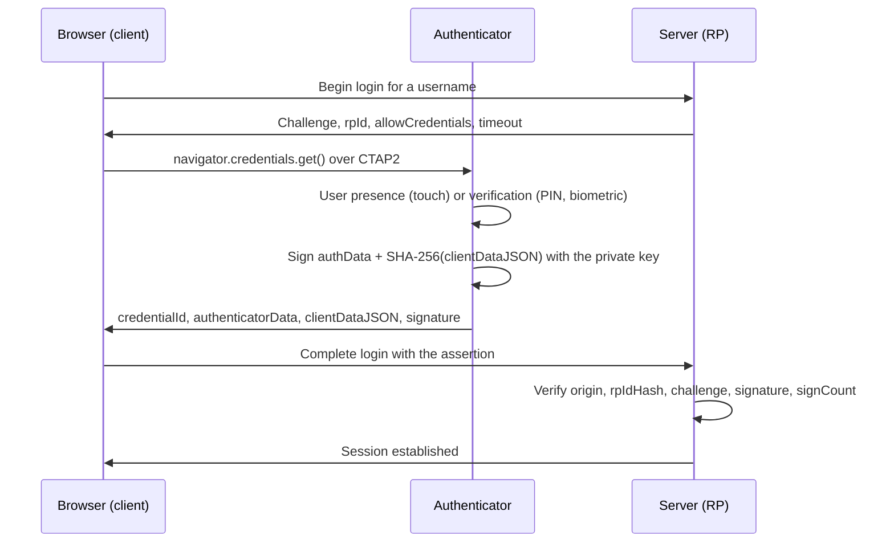

<!-- verified 2026-09-17 -->

import KnowledgeCheck from '@site/src/components/KnowledgeCheck';

# FIDO2 and WebAuthn Deep Dive

Traditional Multi-Factor Authentication (MFA) — including SMS codes, email one-time links, TOTP authenticator apps (RFC 6238), and mobile push notifications — fails catastrophically against modern **Adversary-in-the-Middle (AiTM)** phishing attacks. Reverse-proxy tools like Evilginx transparently proxy authentication traffic between the victim and the legitimate Identity Provider (IdP), intercepting the victim's credentials and the issued session cookies in real time.

**FIDO2** is the only industry authentication standard designed from first cryptographic principles to be fundamentally immune to phishing, credential theft, and replay attacks.

---

## 1. The FIDO2 Ecosystem Components

FIDO2 comprises two coordinated specifications:
1. **WebAuthn (W3C Web Authentication API)**: A JavaScript API implemented natively by modern browsers (`navigator.credentials.create()` and `navigator.credentials.get()`). It allows web applications (Relying Parties - RPs) to orchestrate asymmetric cryptographic key generation and authentication ceremonies.
2. **CTAP2 (Client to Authenticator Protocol)**: The binary protocol allowing the browser/platform to communicate with external hardware authenticators (e.g., YubiKeys, Google Titan keys, biometric readers) over USB, NFC, or Bluetooth Low Energy (BLE).

---

## 2. Authentication Ceremony Walkthrough



*A WebAuthn assertion. The private key never leaves the authenticator, and the signature covers both the server's challenge and the browser's origin, which is what a reverse proxy at another origin cannot reproduce.*

The origin is inside `clientDataJSON`, and the browser fills it in rather than the page. That is the detail that defeats an AiTM proxy: the attacker's site may present the victim's real login page pixel for pixel, but the `clientDataJSON` the browser builds carries `https://evil.example` as the origin, and the server rejects an assertion whose origin is not its own. The `signCount` in `authenticatorData` is the second check: a counter that fails to increase suggests a cloned authenticator, which is why hardware keys that reset it are flagged rather than trusted.

---

## 3. Byte-Level Anatomy of `authenticatorData`

When an authenticator completes an assertion or registration, it returns a binary structure called `authenticatorData` (or `authData`). The Relying Party must parse and validate this buffer byte by byte:

```
+----------------------------------------------------------------------------+
| rpIdHash (32 bytes)                                                        |
+---------------------+------------------------------------------------------+
| flags (1 byte)      | signCount (4 bytes, big-endian)                      |
+---------------------+------------------------------------------------------+
| [Optional] attestedCredentialData (variable length, present on reg)        |
+----------------------------------------------------------------------------+
| [Optional] extensions (variable length)                                    |
+----------------------------------------------------------------------------+
```

### The Flags Byte Breakdown:
The 1-byte flags field contains bitwise indicators critical for security policy enforcement:
- **Bit 0: User Present (UP)**: Set to `1` if the user completed a physical presence test (e.g., touched the hardware button). An authentication attempt without UP must be rejected.
- **Bit 2: User Verified (UV)**: Set to `1` if the user was verified locally by the authenticator via a biometric check (fingerprint/face) or a hardware-validated PIN. UV distinguishes simple possession (something you have) from multi-factor authentication (something you have + something you are/know).
- **Bit 6: Attested Credential Data (AT)**: Set to `1` if the structure includes public key credential data (present during registration).
- **Bit 7: Extension Data Included (ED)**: Indicates presence of FIDO extensions.

### The Clone-Detection Signature Counter (`signCount`):
A 4-byte big-endian unsigned integer that increments on every assertion.
- The Relying Party stores the counter in the user's database record upon each successful login.
- If a subsequent login presents a `signCount` that is **less than or equal to** the stored counter, the server detects that the physical authenticator has been cloned or replayed. The server must immediately lock the credential and trigger an incident alert.

---

## 4. Why Origin Binding Defeats AiTM Phishing

To understand why FIDO2 is phish-proof while TOTP/SMS fails, compare the data signed by the authenticator:

### Structure of `clientDataJSON`:
During authentication, the browser automatically constructs a JSON object:
```json
{
  "type": "webauthn.get",
  "challenge": "dGhpcy1pcy1hLXJhbmRvbS1jcnlwdG8tY2hhbGxlbmdl",
  "origin": "https://login.enterprise.com",
  "crossOrigin": false
}
```

### The Attacker's Dilemma:
Suppose an attacker hosts an Evilginx reverse proxy at `https://login.enterprise.phishingsite.net` and tricks a victim into clicking the link.
1. The victim's browser opens `https://login.enterprise.phishingsite.net`.
2. The attacker's proxy forwards the login request to the legitimate IdP (`login.enterprise.com`), receives the challenge, and passes it back to the victim.
3. The victim's browser invokes `navigator.credentials.get()`.
4. **The Critical Security Gate**: The browser independently queries the operating system window object to determine the actual address displayed in the URL bar: `https://login.enterprise.phishingsite.net`.
5. The browser constructs `clientDataJSON` containing `"origin": "https://login.enterprise.phishingsite.net"`.
6. The authenticator hashes this origin and produces a cryptographic signature.
7. The attacker forwards this signature to the legitimate IdP (`login.enterprise.com`).
8. The legitimate IdP validates the signature:
   ```text
   Verify(signature, authData || SHA-256(clientDataJSON), publicKey)
   ```
9. The IdP parses `clientDataJSON` and inspects the origin claim:
   ```text
   Received Origin = "https://login.enterprise.phishingsite.net" != "https://login.enterprise.com"
   ```
10. **The IdP rejects the authentication outright**. The attacker cannot alter the origin field in `clientDataJSON` because any modification invalidates the cryptographic signature.

**No human vigilance is required**. The browser and the cryptographic signature guarantee that credentials cannot be harvested by a third-party proxy.

---

## 5. Passkeys: Synced vs Hardware-Bound

| Criterion | Hardware-Bound Passkeys (FIDO2) | Synced Passkeys (Multi-Device) |
|---|---|---|
| **Storage Medium** | Secure Element / Hardware Token (YubiKey) | Cloud Keychain (Apple Keychain, Google Password Manager, 1Password) |
| **Exportability** | Non-exportable (private key never leaves chip) | Synced across user devices via end-to-end encrypted backup |
| **NIST Authenticator Level** | **AAL3** (Hardware-backed single factor or multi-factor) | **AAL2** (Multi-device credential) |
| **Risk of Device Loss** | Requires backup key registration or admin recovery | User recovers keys automatically upon signing into their iCloud/Google account |
| **Target Audience** | System administrators, executives, PAM users | General consumers, non-privileged enterprise workforce |

---

<KnowledgeCheck
  question="During a FIDO2 authentication ceremony, what exact mechanism prevents an Adversary-in-the-Middle (AiTM) reverse proxy from relaying the signature to the legitimate Identity Provider?"
  options={[
    {
      id: "A",
      text: "The authenticator requires a one-time SMS verification code before releasing the signature.",
      isCorrect: false,
      explanation: "FIDO2 does not use SMS codes; SMS is an insecure channel vulnerable to interception and SIM-swapping."
    },
    {
      id: "B",
      text: "The browser automatically populates the real URL origin into clientDataJSON; any proxy URL causes an origin mismatch when verified by the legitimate IdP, which cannot be forged without breaking the cryptographic signature.",
      isCorrect: true,
      explanation: "Cryptographic origin binding ensures the signature covers the exact domain displayed in the browser bar. The legitimate IdP expects its own domain and rejects signatures generated for the phishing domain."
    },
    {
      id: "C",
      text: "The YubiKey establishes a direct encrypted satellite connection to the enterprise IdP server.",
      isCorrect: false,
      explanation: "Authenticators communicate only with the host device over local buses (USB, NFC, BLE) using CTAP2; they do not have independent wide-area network connectivity."
    },
    {
      id: "D",
      text: "The authenticator encrypts the user's password using AES-256.",
      isCorrect: false,
      explanation: "FIDO2 is completely passwordless. Passwords are never used, stored, or transmitted during the ceremony."
    }
  ]}
  takeaway="Enforce FIDO2/WebAuthn (or Certificate-Based Authentication) for all administrative and privileged access. It is the only authentication standard that renders reverse-proxy phishing technologically impossible."
/>
