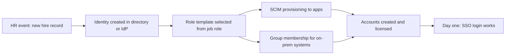

# Onboarding (Joiner)

The joiner scenario is where identity management earns its keep. A new employee needs accounts, permissions, and systems access, ideally before their first day, with nothing granted beyond what their role requires. This page walks the pipeline from the HR event to first login.

## The provisioning pipeline

A typical medium-size organization provisions a new hire through this sequence:

The HR system is the source of truth for who works where. The directory or IdP is the system of record for identity. Applications are downstream consumers, fed by [SCIM provisioning](/docs/protocols-iga/scim) where the app supports it, or by group-based account creation where it does not.

## The role template

The single most important decision in joiner onboarding is which [role template](/docs/fundamentals/authorization) the new hire maps to. Suppose Northwind Systems, a fictional 200-person software company, hires a support engineer. The HR record says department = Customer Support, job code = SUPP-1. The identity team has a role template for that job code that contains:

- A directory group `APP-support-agents` with membership in the ticket system and the knowledge base.
- A licensed seat in the support tooling.
- A baseline set of standard entitlements every employee gets: email, chat, file storage, intranet.
- No access to finance, production infrastructure, or the customer database, because the template does not include those groups.

The template grants the role, not the person. When the hire moves to a different job later, the [mover process](02-role-change.md) swaps templates and the old entitlements fall away automatically.

## What a good joiner process includes

- **Pre-hire identity creation.** The account is created and provisioned days before the start date, with credentials issued through a self-service flow on day one rather than emailed.
- **One identity, one set of credentials.** The directory account is the anchor; applications authenticate against it via [SSO](/docs/protocols-iga/saml) instead of creating separate passwords.
- **Least privilege by construction.** The default is no access; role membership adds access. The joiner is not granted anything "to be safe".
- **An approval trail.** The hiring manager approves the role selection in the [IGA system](/docs/protocols-iga/iga), which produces the audit record needed later for [certification](05-certification-campaign.md).
- **Privileged accounts handled separately.** If the role includes admin rights, those come through the [privileged access flow](04-privileged-access-request.md) with time-boxed grants, never as standing membership in a domain admin group.

## Day-one experience

The measure of a good joiner process is that the employee signs in once, sees the applications they need, and requests anything missing through self-service. Every access request the employee has to file on day one is a gap in the role template worth fixing. Track requests by job code; a template that generates frequent day-one requests is a template that needs another entitlement.

## Common failure modes

- **Identity created but provisioning skipped.** The directory account exists, the app accounts do not, because a connector failed silently. This is why [SCIM monitoring](14-troubleshooting-scim.md) matters.
- **Role template drift.** The template says `APP-support-agents`, but the actual group for the ticket system is `ticket-support-staff` and the template was never updated after a rename. The joiner gets no access and the ticket takes an hour to resolve.
- **Duplicate identities.** The joiner was created in the directory in the pre-hire phase, and a manager created a second account in the app directly. The [identity lifecycle](/docs/fundamentals/identity-lifecycle) page covers why duplicate identities are dangerous: two identities for one person means one of them will not be deprovisioned at termination.

## Next

The reverse scenario is [Termination (Leaver)](03-termination.md), and between the two sits the less dramatic but more common [Role change (Mover)](02-role-change.md).