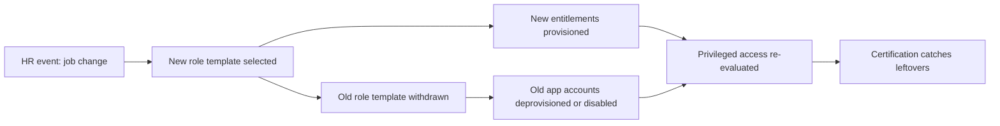

# Role Change (Mover)

The mover is the most common identity event after the joiner, and the one organizations most often get wrong. A promotion, a transfer, or a team change means the person needs new access and, critically, should lose old access. The mover process is where role-based access control pays off, because the identity is re-provisioned from the new role instead of incrementally patched.

## Why movers accumulate access

Without a deliberate mover process, the pattern is predictable:

1. Employee transfers from Engineering to Customer Success.
2. The new manager requests access for the new role: CRM, support tooling, the new team's document library.
3. Nobody removes the old access: source repos, build systems, internal tooling credentials.
4. The employee now holds the combined access of two roles, which is more than either role justifies.

Accumulation is how the average employee ends up with permissions their job never required, which is exactly the problem [identity lifecycle](/docs/fundamentals/identity-lifecycle) is designed to prevent. Access reviews find these stale grants eventually, but the mover process should remove them on day one.

## The mover pipeline

The key step is the withdrawal of the old role template, not the addition of the new one. The directory group membership is recalculated from the new template, so the employee leaves the old groups, and downstream provisioning removes the app accounts that referenced them.

## What the mover process requires

- **HR event accuracy.** The trigger is the same as joiner: an HR record change. A manager calling the help desk to "add this person to the CRM group" is not a mover event, it is an access request, and it does not trigger withdrawal of anything.
- **A transition window where both accesses exist.** Most transfers include a handover period where the employee winds down old duties. The process should support a dated transition: new role active immediately, old role expiring at the handover date. The expiry must be automatic, not a calendar reminder.
- **Privilege re-evaluation, not inheritance.** If the employee held [privileged access](/docs/pam-core/what-is-pam) in the old role, the move is the moment to review whether the new role still justifies it. Moving from Engineering to Sales should not carry domain admin rights along.
- **An approval from the losing manager.** The person leaving the team signs off on the access transfer. This single step prevents the most common mover dispute: the old manager discovering three months later that the departed employee still holds the team's secrets.

## The mover in the IGA loop

The [access certification](05-certification-campaign.md) campaign is the safety net under the mover process. When the certification reviewer sees a user whose groups no longer match their job function, that is the system flagging a mover that was never processed. Organizations that run the mover process cleanly see their certification campaigns shrink every cycle, because the dirty data never accumulates.

## Failure modes

- **Old access persists because the old role was never formally withdrawn.** The person "left the team" in the informal sense but the HR record still says the old department.
- **App accounts orphaned by group changes.** The identity provider updated group membership, but the app's connector maps groups to local roles and the local role persists after the group is empty. The [SCIM troubleshooting guide](14-troubleshooting-scim.md) covers how to detect and clean these.
- **Privileged grants outlive the role.** A time-boxed admin grant expires, but the support engineer keeps the standing local admin account created during the move. The [JIT access](/docs/pam-core/jit-access) pattern exists to prevent exactly this.

## Next

The mover's edge case is the [Termination (Leaver)](03-termination.md) scenario, where the access must be withdrawn completely and quickly.