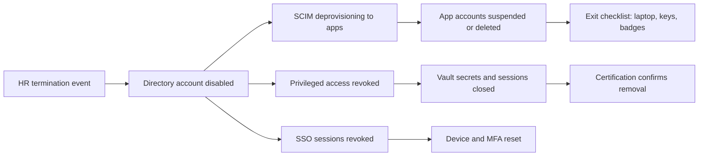

# Termination (Leaver)

Termination is the scenario where identity management failures become incidents. A departed employee with a still-valid account is a standing risk: credentials can be reused, sessions can be resumed, and data can be accessed after the relationship ends. The leaver process exists to make the account unusable promptly and completely, and then to prove it.

## Standard offboarding

The sequence matters: disable the identity first, revoke sessions second, deprovision the apps third. The directory account is the anchor. Once it is disabled, SSO authentication fails, and the downstream deprovisioning removes the app accounts.

## The termination checklist

- **Directory account disabled, not deleted.** Deletion breaks audit history and can orphan data references. Disable on termination day, archive after the retention window, and keep the audit record of the actions taken.
- **Sessions revoked.** Active SSO sessions and refresh tokens must be invalidated, not just the login blocked. A user logged in at 4:50 PM who is terminated at 5:00 PM still has a live session until the IdP expires it. Most identity platforms support session revocation by user; use it.
- **MFA reset and device returned.** The phone that holds the authenticator app is a credential. Revoke the device registration and wipe or re-enroll the hardware.
- **Privileged access closed.** Vault sessions terminated, [JIT grants](/docs/pam-core/jit-access) expired, standing admin memberships removed. A terminated admin with a valid vault session can still reach the whole estate through the PAM session.
- **Mailbox and data handover.** The manager decides whether the mailbox forwards or archives. This is an HR and legal decision, but the identity team executes it, so it belongs on the checklist.
- **Certification catch.** The next [certification campaign](05-certification-campaign.md) should show zero residual access for the departed user. If it shows any, the process failed somewhere.

## Emergency offboarding

Emergency offboarding compresses the checklist to the steps that stop access immediately. Use it when the termination is hostile, the employee is terminated for cause, or there is a credible risk of retaliation:

1. Disable the directory account and force sign-out of all sessions. This is the single step that stops almost everything.
2. Revoke privileged access and terminate active PAM sessions at the vault.
3. Rotate credentials the person possessed, starting with any [shared or service accounts](/docs/pam-core/what-is-pam) they knew. Treat knowledge as compromise: the account they touched is rotated, not just disabled.
4. Disable or remove the MFA device registrations.
5. Collect the audit trail now, while the events are fresh: sign-in logs, PAM session recordings, file access history. This material is evidence, so it is captured before any other cleanup.
6. Complete the rest of the standard checklist when time allows.

The first three steps take minutes. Everything else can follow.

## The risk that survives termination

The termination process only protects the accounts the organization knows about. The leaver who set up a personal admin account on a server, or whose credentials live in a [service account](07-saas-sso-integration.md) that was never inventoried, remains reachable. This is why the [discovery and inventory](/docs/pam-core/core-capabilities) work in the PAM domain matters: the organization can only terminate what it knows exists.

## Next

With the lifecycle complete, the remaining scenarios are the operational ones: [Privileged access request](04-privileged-access-request.md), [Access certification](05-certification-campaign.md), [MFA enrollment and recovery](06-mfa-enrollment-recovery.md), and [SaaS SSO integration](07-saas-sso-integration.md).