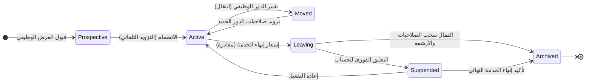

<!-- verified 2026-09-17 -->

# دورة حياة الهوية (Joiner, Mover, Leaver)

سجلات الهوية الرقمية ليست كيانات ثابتة؛ فالموظف ينضم إلى المنظمة، ويغير أدواره وأقسامه بمرور الوقت، ثم يغادرها في النهاية. كل انتقال من هذه الانتقالات يغير بشكل جذري ما يجب أن يحمله من صلاحيات. يحدد نموذج دورة حياة الهوية هذه المراحل الحاكمة ويُعرف في الممارسات الأمنية اختصاراً بـ **JML** (**Joiner**, **Mover**, **Leaver**).

---

## 1. الانضمام (Joiner): التزويد وفق الدور وليس الشخص

عند انضمام موظف جديد، تُنشأ هويته وتُزود بالصلاحيات التي تتطلبها مهام وظيفته. يسود هذا الشق نمطان خطران من الأخطاء:

- **الإفراط في منح الصلاحيات في اليوم الأول (Over-provisioning)**: الخطأ الشائع المتمثل في *"انسخ صلاحيات زميله السابق في نفس الوظيفة"* ينشئ صلاحيات فائضة وغير مراجعة. يجب أن يكون التزويد نابعاً من **قالب الدور الوظيفي (Role Profile)** وليس من استنساخ صلاحيات شخص آخر.
- **التزويد اليدوي العشوائي**: عندما تُنشأ الحسابات يدوياً على كل نظام، تعتمد دقة العملية على مزاج وخبرة مسؤول النظام المناوب. تضمن الأتمتة (عبر بروتوكول SCIM وحلول IGA) اتساق مسار الانضمام وقابليته للتدقيق البرمجي.

---

## 2. الانتقال الوظيفي (Mover): انتقال الصلاحيات وسحب القديمة

تغيير الدور الوظيفي هو النقطة التي يبدأ عندها **تآكل الصلاحيات (Access Decay)** في أغلب المنظمات. فعندما ينتقل موظف من إدارة العمليات إلى إدارة المشتريات، فإن الخطأ الكارثي الأكثر شيوعاً هو إضافة صلاحيات المشتريات الجديدة دون سحب صلاحيات العمليات السابقة.

النتيجة: يصبح الموظف مالكاً لـ **مجموع كافة الصلاحيات** التي حازها في مسيرته بالشركة، وهو ما يُعرف بـ **تراكم الصلاحيات (Privilege Creep)**.

### يجب أن يتضمن مسار الانتقال الوظيفي الآمن:
- إعادة تشغيل خوارزمية التزويد لتحديد استحقاقات الدور الجديد فقط.
- **السحب التلقائي والفوري لكافة الاستحقاقات** المرتبطة بالدور القديم.
- إعادة فحص قواعد **الفصل بين المهام (Segregation of Duties - SoD)**، حيث يمكن أن يؤدي الانتقال إلى توليفة خطرة (مثل أن يملك الموظف حق إنشاء طلب الصرف واعتماده في آن واحد).

---

## 3. المغادرة وإنهاء الخدمة (Leaver): المرحلة الأشد خطورة

إنهاء الخدمة هو الاختبار الحقيقي لنضج برنامج إدارة الهوية. حساب الموظف المغادر هو بمثابة بيانات اعتماد مهجورة وغير مراقبة تملك وصولاً للأنظمة الحساسة. يُعد أي تأخير في إلغاء تفعيل حسابات المغادرين سبباً مباشراً للتهديدات الداخلية وأول ما يدونه مدققو الامتثال كملاحظة حرجة.

### الإجراءات الإلزامية في مرحلة المغادرة:
1. **التعطيل الفوري والشامل (Account Disablement)**: إيقاف الحساب فوراً عند لحظة إنهاء الخدمة، بما في ذلك حسابات الخدمة المقترنة بالشخص.
2. **إبطال كافة بيانات الاعتماد اللحظي**: إلغاء رموز OAuth النشطة، وجلسات SSO، ورموز التحديث (Refresh Tokens)، وحذف المفاتيح المسجلة.
3. **التعليق كحالة وسطية (Suspended)**: في حالات النزاع الوظيفي أو فترات الإشعار، يُعلق الحساب لمنع الدخول مع الحفاظ على البيانات للفحص الجنائي.
4. **الأرشفة وفق سياسة الاحتفاظ بالبيانات**: حذف الحساب بعد فترة زمنية محددة نظامياً مع الاحتفاظ بسجلات التدقيق لمتطلبات القوانين الرقابية.

التالي: **[مبدأ الامتياز الأقل وبنية الثقة المعدومة](04-least-privilege-zero-trust.md)**: المبادئ الحاكمة لضبط الصلاحيات ومكافحة الثقة الضمنية.
