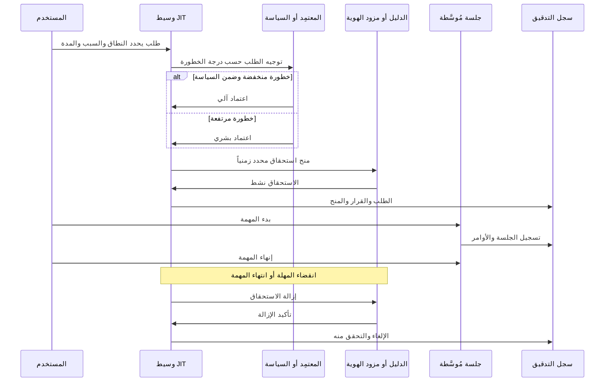

# الوصول في الوقت المناسب (Just-in-Time Access)

يمثل الوصول في الوقت المناسب (Just-in-Time - JIT) نمط منح الامتيازات والصلاحيات الإدارية **فقط عند حاجة المهمة التشغيلية إليها، ولأقصر مدة زمنية ممكنة، وسحبها تلقائياً وفور انتهاء المهمة**. إنه الرد الهندسي والعملي على مخاطر الصلاحيات الدائمة (Standing Privileges): فبدلاً من التساؤل "من يمتلك صلاحيات المسؤول في الشركة؟"، يصبح التساؤل الأمني الحاسم: "من يمتلك صلاحيات المسؤول *في هذه اللحظة بالذات*؟"، والهدف الاستراتيجي هو تقليص هذا العدد إلى الصفر في الأوقات الاعتيادية.

import Drawio from '@site/src/components/Drawio';
import arch from '!!raw-loader!@site/static/diagrams/jit-access-flow.drawio';

<Drawio content={arch} />

*مسار عمل الوصول في الوقت المناسب (JIT): الطلب، الاعتماد، المنح، الاستخدام، الإلغاء، والتدقيق. المنح محدد زمنياً بطبيعته، والإلغاء آلي ومتحقق منه برمجياً، وكل مرحلة موثقة في سجلات التدقيق.*

<a href="/diagrams/jit-access-flow.drawio" download>تحميل / تعديل هذا المخطط</a>

## المسار الإجرائي والتقني خطوة بخطوة

**1. الطلب (Request):** يتقدم المستخدم بطلب تصعيد الصلاحية مقدماً ثلاثة بيانات أساسية: تذكرة العمل أو المبرر التشغيلي، نطاق النظام المستهدف بدقة، والمدة الزمنية المطلوبة. يمثل نموذج الطلب خط الدفاع الأول: فالطلب الذي يعجز عن تحديد مهمة محددة ونطاق مقيد يُرفض تلقائياً.

**2. الاعتماد (Approve):** يقوم المسؤول المعتمد (المدير المباشر، مسؤول الأمن السيبراني، أو محرك تقييم المخاطر المؤتمت) بمراجعة الطلب. توجه البرامج الناضجة الطلبات وفقاً لمستوى المخاطرة: الطلبات الروتينية منخفضة الخطورة تُعتمد آلياً وفق السياسة، بينما تتطلب العمليات الحرجة موافقة بشرية صريحة مع توثيق هوية المعتمد.

**3. المنح (Grant):** يُصدر وسيط JIT الصلاحية المطلوبة عبر: عضوية مجموعة مؤقتة، أو تفعيل دور سحابي محدد، أو إصدار اعتماد مؤقت. تُقاس المدة الافتراضية بالدقائق أو الساعات القليلة مع وجود حد أقصى غير قابل للتجاوز.

**4. الاستخدام (Use):** يُنفذ المستخدم مهامه عبر جلسة مدارة ومراقبة بواسطة [وسيط الجلسات PSM](05-pam-architecture.md)، حيث تُنسب الجلسة للمستخدم الحقيقي وتُسجل بالكامل.

**5. الإلغاء والتحقق (Revoke & Verify):** تنتهي الصلاحية تلقائياً بمجرد انقضاء المهلة الزمنية المحددة أو بإشعار اكتمال المهمة. **الإلغاء يجب أن يكون آلياً ومتحققاً منه (Verified Revocation)**: حيث يفحص النظام خروج المستخدم من المجموعة أو إبطال المفتاح فعلياً؛ فالإلغاء غير المؤكد هو مجرد صلاحية دائمة مقنعة.

**6. التدقيق الشامل (Audit):** توثيق دورة العمل بأكملها: من طلب، ومن وافق، وما النطاق الممنوح، وما الأوامر المنفذة أثناء الجلسة، ومتى سُحبت الصلاحية.

### الدورة نفسها بأطرافها

*دورة JIT بأطرافها. الطلب والاعتماد والمنح والاستخدام والإلغاء أحداث منفصلة لكل منها سجل مستقل، وآخرها قراءة تأكيدية من الدليل لا افتراض من الوسيط.*

القراءة التأكيدية هي الخطوة التي تتجاهلها معظم التطبيقات. فالوسيط الذي يستدعي واجهة الإزالة ويسجل «أُلغيت الصلاحية» يكون قد سجل نيّة لا حالة. يجب إعادة قراءة عضوية المجموعة أو إسناد الدور أو بيانات الاعتماد والتأكد من زوالها، لأن فشل الإزالة يبدو في سجل الطلبات مطابقاً تماماً لنجاحها. والقاعدة نفسها تنطبق على مسار الانتهاء: إغلاق النافذة الزمنية ليس بذاته دليلاً على انتهاء الامتياز.

## الأنماط المعمارية لتطبيق وصول JIT

يتحقق نمط JIT في أربعة أشكال هندسية رئيسية:

- **عضوية المجموعات سريعة الزوال (Ephemeral Group Membership):** إضافة المستخدم إلى مجموعة ذات امتيازات لفترة محددة ثم حذفه آلياً (مدعومة أصلياً في Active Directory وEntra ID وAWS IAM Identity Center).
- **تفعيل الأدوار المحددة زمنياً (Time-Boxed Role Activation):** مثل أدوار Azure PIM أو مجموعات أذونات AWS، حيث يمتلك المستخدم "أهلية مسبقة" للدور (Eligible)، ويقوم بتفعيله عند الحاجة فقط.
- **الجلسات المؤقتة المدارة عبر وسيط (Brokered Sessions):** تُمنح الصلاحية حصرياً داخل نفق جلسة وسيط PSM، وتنتهي وتتلاشى بمجرد إغلاق نافذة الاتصال.
- **سحب بيانات الاعتماد مع التدوير التلقائي (Check-Out with Auto-Rotation):** تسليم كلمة المرور للمستخدم لنافذة زمنية ثم تدويرها فور استرجاعها.

## لماذا يتفوق JIT على الصلاحيات الدائمة؟

- **انكماش سطح الهجوم (Attack Surface Reduction):** الصلاحية الدائمة متاحة للهجوم والاستغلال على مدار الساعة (24/7)، بينما صلاحية JIT لا تظهر إلا لدقائق معدودة. المهاجم الذي يخترق هوية مسؤول لا يجد صلاحيات جاهزة لاستغلالها، وأي محاولة لطلب الصلاحية تطلق الإنذارات فوراً في مركز SOC.
- **مساءلة قانونية وسجل كامل لكل حركة:** كل استخدام يحمل بطاقة تعريف واضحة تجيب عن أسئلة التدقيق الأمني دون لبس.
- **حصار الاختراق في نافذة زمنية ضيقة:** حتى في أسوأ سيناريوهات نجاح المهاجم في الحصول على صلاحية، فإن نافذة الخطر تنتهي بانتهاء المهلة المحددة دون أن تمتد إلى ما لا نهاية.

## الانضباط التشغيلي لضمان نجاح JIT

يفشل تطبيق JIT لأسباب تنظيمية وثقافية شائعة:
1. **الموافقات الصورية (Rubber-Stamp Approval):** الموافقة العشوائية على كافة الطلبات دون تدقيق تحول المنظومة إلى مجرد إجراء شكلي.
2. **المهل الزمنية المفرطة:** طلب الوصول ليوم كامل أو أسبوع بحجة "الحاجة المحتملة" يعيد إحياء الصلاحيات الدائمة.
3. **غياب التحقق من الإلغاء:** الاعتماد على أوامر الإلغاء دون التحقق البرمجي من سحب الصلاحيات فعلياً من الأنظمة المستهدفة.
4. **المسارات الموازية والأبواب الخلفية:** احتفاظ بعض المهندسين بحسابات مسؤول محلي مباشرة على الخوادم خارج مظومة JIT يفرغ المشروع من قيمته الأمنية.

التالي: [انعدام الامتيازات الدائمة (ZSP) وPAM سريع الزوال](14-ephemeral-pam-zero-standing-privilege.md)، النقلة المعمارية المتقدمة التي تقضي على الخزائن الثابتة بالاعتماد على الشهادات اللحظية.