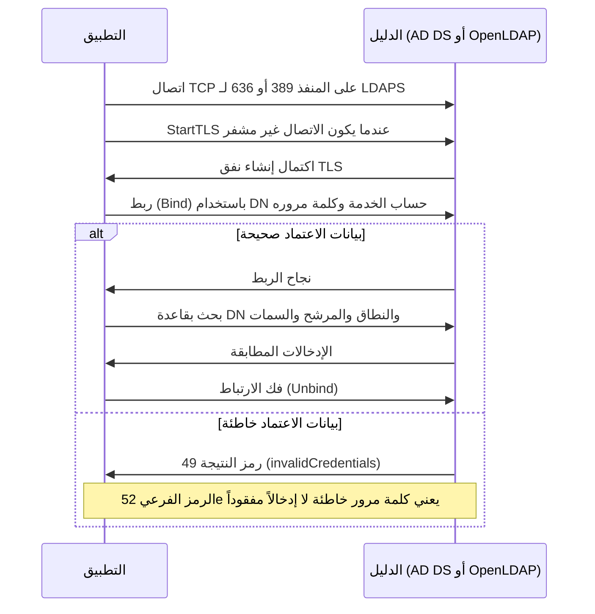

# بروتوكول LDAP

يُعد بروتوكول الوصول إلى الدليل الخفيف (Lightweight Directory Access Protocol - LDAP) البروتوكول المعياري لقراءة والبحث في خدمات الدليل (Directory Services)، وهي قواعد بيانات مهيكلة ومخصصة لتخزين الهويات، المجموعات، وسماتها الوظيفية. يُعتبر LDAP البروتوكول الأقدم في منظومة إدارة الهوية والوصول (IAM)، وما يزال يمثل العمود الفقري لإدارة الهويات المؤسسية نظراً لأن الأنظمة الرائدة، مثل Microsoft Active Directory (AD DS) وOpenLDAP، تعتمد عليه كلياً في استرجاع الهياكل التنظيمية.

## بنية الدليل وشجرة معلومات الدليل (DIT)

الدليل هو قاعدة بيانات مُحسّنة لعمليات القراءة المكثفة (Many Lookups, Few Writes) بنموذج هرمي قائم على السمات (Attributes). وخلافاً لقواعد البيانات العلائقية، لا تُمثَّل البيانات في صفوف وجداول، بل تتكون كل مدخلة (Entry) من حزمة من السمات (مثل `mail`، `uid`، `department`)، وتُعرّف كل مدخلة بما يُعرف بالاسم المميز (Distinguished Name - DN) الذي يُحدد بدقة مسار وموقع المدخلة داخل الشجرة. تُسمى هذه البنية الهرمية بشجرة معلومات الدليل (Directory Information Tree - DIT).

import Drawio from '@site/src/components/Drawio';
import dit from '!!raw-loader!@site/static/diagrams/ldap-dit.drawio';

<Drawio content={dit} />

*بنية شجرة معلومات الدليل (DIT): تتدرج من جذر النطاق (Domain Component - DC) مروراً بالوحدات التنظيمية (Organizational Units - OUs) وصولاً إلى كائنات المستخدمين؛ وتمتلك كل مدخلة اسماً مميزاً فريداً (DN) مستمداً من مسارها الهرمي الكامل.*

<a href="/diagrams/ldap-dit.drawio" download>تحميل / تعديل هذا المخطط</a>

## العمليات الأساسية في LDAP

تنحصر تفاعلات العميل مع خادم LDAP في مجموعة محددة من العمليات البرمجية:

| العملية (Operation) | الغرض التشغيلي والتقني |
|---|---|
| **الربط (Bind)** | مصادقة العميل لدى الخادم، إما كجلسة مجهولة (Anonymous) أو باستخدام بيانات اعتماد (Bind DN وكلمة المرور). |
| **البحث (Search)** | الاستعلام عن المدخلات وتصفيتها وفقاً لمعايير: قاعدة البحث (Base DN)، نطاق البحث (Scope: Base/OneLevel/Subtree)، ومرشح البحث (Filter). |
| **المقارنة (Compare)** | التحقق مما إذا كانت مدخلة ما تمتلك قيمة معينة لسمة محددة دون الحاجة لاسترجاع كامل بيانات الكائن. |
| **الإضافة / التعديل / الحذف (Add / Modify / Delete)** | عمليات الكتابة والتحديث على كائنات وسمات الدليل. |
| **العمليات الموسعة (Extended Operations)** | امتدادات وظيفية للبروتوكول، وأبرزها ترقية الاتصال غير المشفر إلى اتصال آمن عبر `StartTLS`. |

تُشكل عملية الربط (Bind) جوهر تكامل أنظمة IAM مع الدليل: حيث تقوم تطبيقات المؤسسة ومزودو الهوية (IdPs) بالربط باستخدام حساب خدمة (Service Account)، ثم تنفيذ استعلامات البحث للتحقق من المجموعات والمستخدمين. ويُعد بناء مرشحات البحث (Search Filters)، مثل:

```ldap
(&(objectClass=user)(sAMAccountName=alimi)(memberOf=cn=sec-ops,ou=Groups,dc=corp,dc=local))
```

أحد أهم المهارات العملية التي يمارسها مهندس الهوية يومياً لحصر وتصفية مجموعات الصلاحيات.

### تكامل واحد، رسالة برسالة

تتركب العمليات السابقة في تبادل واحد، وهو الشكل الذي تتبعه غالبية التطبيقات التي تعتمد LDAP:



*تبادل LDAP من الاتصال إلى فك الارتباط. يحدد ربط حساب الخدمة الهوية التي يجري البحث تحتها، ويقوم المرشح بالاستعلام، ويحمي StartTLS أو LDAPS بيانات الاعتماد على الشبكة.*

يتطلب التحقق من كلمة مرور المستخدم خطوة إضافية عادة: يربط التطبيق حساب الخدمة، ثم يبحث عن DN المستخدم، ثم يربط مجدداً بذلك الـ DN وكلمة المرور التي أدخلها المستخدم. نجاح الربط الثاني هو الإثبات، فالدليل لا يعيد كلمة المرور المخزنة للمقارنة. ولهذا يظهر فشل دخول المستخدم كفشل في الربط لا كرسالة «المستخدم غير موجود»، ولهذا أيضاً يكون الخطأ 49 مع الرمز الفرعي 52e أكثر سطر يتكرر في تذاكر استكشاف أخطاء LDAP.

## موقع LDAP ضمن منظومة إدارة الهوية (IAM)

يؤدي LDAP عدة أدوار محورية داخل البنية التحتية للهوية:

- **مستودع الهويات المعتمد (Authoritative User Store):** يمثل الدليل المصدر الأساسي لبيانات الأفراد وسماتهم الإدارية (القسم، المدير المباشر، البريد، والانتماء للمجموعات).
- **مصدر المصادقة التقليدي (Authentication Source):** يعتمد النمط التقليدي على تنفيذ عملية Bind للتحقق من صحة كلمة مرور المستخدم. وتعتبر معايير IAM الحديثة هذا النمط مساراً احتياطياً فقط، نظراً لأنه يُلزم التطبيق باستلام وتمرير كلمة مرور المستخدم بنفسه.
- **تغذية القرارات الصلاحية عبر المجموعات (Group Membership):** تعتمد التطبيقات على مجموعات الدليل (`cn=finance-team,ou=Groups,...`) لبناء قرارات التخويل؛ لذا فإن حوكمة ونظافة مجموعات الدليل أمر بالغ الخطورة، إذ يعامل التطبيق مجموعات الدليل كأدوار وظيفية مباشرة له.
- **إدارة حسابات الخدمة والأنظمة:** يُخزن Active Directory وOpenLDAP حسابات الخدمات والأنظمة البرمجية التي تعتمد عليها الخوادم والخدمات في التحقق والاتصال.

## المتطلبات والضوابط الأمنية

1. **إلزامية التشفير أثناء النقل (Encryption in Transit):** ينقل بروتوكول LDAP العادي بيانات الاعتماد بنص صريح (Cleartext). يُعد استخدام LDAPS (عبر منفذ 636 مع TLS) أو تفعيل StartTLS (عبر منفذ 389 وترقية الاتصال) الحد الأدنى غير القابل للتفاوض، ويُعتبر استمرار الربط غير المشفر ثغرة حرجة في أي تقييم أمني.
2. **الربط البسيط مقابل SASL (Simple Bind vs SASL):** يُرسل الربط البسيط كلمة المرور مباشرة في القناة؛ بينما توفر آليات طبقة الأمان والمصادقة البسيطة (SASL) - مثل Kerberos/GSSAPI أو الشهادات الرقمية EXTERNAL - إمكانية إتمام المصادقة دون تمرير كلمة مرور قابلة لإعادة الاستخدام عبر الشبكة.
3. **سياسات الإغلاق ومراقبة محاولات التخمين:** تتولى خدمة الدليل تطبيق ضوابط إغلاق الحسابات (Account Lockout) وتحديد معدل الطلبات (Rate Limiting). أي قصور في تفعيل هذه الضوابط يحول خادم الدليل إلى هدف سهل لهجمات القوة الغاشمة (Brute-Force).
4. **تقييد نطاق البحث وحظر الاستعلام المجهول:** يتيح الاستعلام المجهول (Anonymous Search) بمرشحات واسعة استخراج قاعدة مستخدمي المؤسسة بالكامل؛ لذا تنطبق مبادئ الامتياز الأقل على حقوق القراءة والاستعلام داخل الدليل.

## الفارق بين LDAP وبروتوكولات الدخول الموحد الحديثة

LDAP هو **بروتوكول دليل (Directory Protocol)** وليس **بروتوكول دخول موحد (SSO Protocol)**. يقتصر دوره على الإجابة عن تساؤلين: "هل بيانات الاعتماد هذه صحيحة لهذا الكائن؟" و"ما هي السمات المسجلة لهذا المستخدم؟". ولا يمتلك القدرة على إصدار رموز جلسات مشفرة (Session Tokens) للتطبيقات الموزعة عبر السحابة. لذا تُبنى المعماريات الحديثة بالإبقاء على الدليل كمستودع تخزين مركزي، ووضع بروتوكولات OIDC وSAML كواجهة أمامية لخدمة التطبيقات (انظر: [المعمارية المتكاملة لإدارة الهوية](07-iam-architecture.md)).

التالي: [بروتوكول SAML](02-saml.md)، البروتوكول الذي أُسس لحل مشكلة الدخول الموحد المؤسسي وتكامل تطبيقات SaaS.