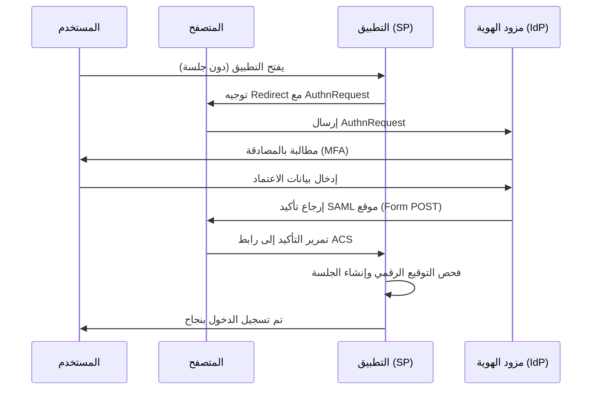

# بروتوكول SAML 2.0

تُعد لغة ترميز تأكيد الأمان (Security Assertion Markup Language - SAML) بروتوكول الدخول الموحد القياسي في البيئات المؤسسية: حيث يُسجل المستخدم دخوله لمرة واحدة لدى مزود هوية مركزي (IdP) ليتمكن من الوصول إلى كافة تطبيقات المؤسسة وخدمات SaaS دون الحاجة لإعادة تقديم بيانات الاعتماد. يعتمد البروتوكول على هيكلية XML، وقد نشأ قبل ظهور OIDC وما يزال البروتوكول السائد في تكاملات الحوسبة السحابية المؤسسية والاتحادات الأكاديمية والحكومية.

## نموذج العمل: مزود الخدمة (SP) ومزود الهوية (IdP)

يقوم نموذج SAML على دورين رئيسيين:

- **مزود الهوية (Identity Provider - IdP):** الجهة المسؤولة عن التحقق من هوية المستخدم وإصدار تأكيدات مشفرة وموقعة رقمياً تثبت صحة هويته وسماته.
- **مزود الخدمة (Service Provider - SP):** التطبيق المستهدف الذي يرغب المستخدم في الوصول إليه؛ ويثق بمزود الهوية ويستهلك تأكيداته لإصدار جلسة عمل محلية.

تُبنى الثقة التبادلية بين الطرفين عبر تبادل البيانات الوصفية (Metadata): حيث ينشر كل طرف شهاداته الرقمية العامة ونقاط النهاية (Endpoints)، ويتحقق كل طرف من التواقيع الرقمية للطرف الآخر. لا توجد حالة جلسة مشتركة بين الخوادم، بل ترتكز الثقة بالكامل على التوقيع الرقمي المشفر المهيأ مسبقاً.

## مسار العمل: الدخول الموحد بمبادرة من التطبيق (SP-Initiated SSO)

*مسار الدخول الموحد بمبادرة من التطبيق (SP-Initiated): يُعاد توجيه المستخدم إلى مزود الهوية، وتتم المصادقة، ثم يُعيد مزود الهوية تأكيداً رقمياً موقعاً (Signed Assertion) يتحقق منه التطبيق قبل إنشاء جلسة العمل.*

يحمل تأكيد SAML ادعاءات الهوية الأساسية: معرف المستخدم (`NameID`)، السمات الوظيفية (`mail`، `groups`، `department`)، وشروط الصلاحية مثل نافذة الصلاحية الزمنية (`NotBefore` و`NotOnOrAfter`) والجمهور المستهدف (`AudienceRestriction`). ويُعد تقييد الجمهور في غاية الأهمية لمنع استغلال تأكيد صادر لتطبيق معين في تسجيل الدخول إلى تطبيق آخر.

## المقارنة بين مسار SP-Initiated ومسار IdP-Initiated

- **SP-Initiated (بمبادرة من التطبيق):** يبدأ المسار بطلب المستخدم الوصول إلى التطبيق مباشرة، فيقوم التطبيق بتوليد طلب مصادقة `AuthnRequest` وتوجيه المتصفح إلى IdP. يُعد هذا المسار المعياري والأكثر أماناً لكافة التطبيقات التفاعلية.
- **IdP-Initiated (بمبادرة من مزود الهوية):** يبدأ المسار من بوابة مزود الهوية (مثل شاشة تشغيل التطبيقات المركزية)، حيث يضغط المستخدم على أيقونة التطبيق، فيُصدر IdP تأكيداً مباشراً دون طلب مسبق ويرسل المتصفح إلى رابط ACS الخاص بالتطبيق. يحمل هذا النمط مخاطر أمنية معروفة: فالتطبيق يتلقى تأكيداً غير مسبوق بطلب، مما يعطّل التحقق من حقل `InResponseTo` ويزيد من مخاطر هجمات تثبيت الجلسة (Session Fixation).

## المخاطر والثغرات الشائعة في تكامل SAML

1. **قصور فحص وتدقيق التوقيع الرقمي (Signature Verification Gaps):** إذا لم يتحقق مزود الخدمة من توقيع عنصر التأكيد بدقة، أو اكتفى بفحص جزء من المستند بدلاً من التوقيع الكامل، يصبح التطبيق عرضة لهجمات **تغليف توقيع XML (XML Signature Wrapping - XSW)**، حيث يحقن المهاجم تأكيداً مزوراً إلى جانب تأكيد موقع شرعي لخداع محرك التحليل.
2. **ارتباك معرف الاسم (NameID Confusion):** إذا غيّر مزود الهوية صيغة أو قيمة `NameID` (مثلاً الانتقال من البريد الإلكتروني إلى معرف GUID الفريد)، يبدأ مزود الخدمة تلقائياً في إنشاء هويات مستخدمين جديدة مكررة، مما يؤدي إلى ضياع الحسابات وخلل فادح في حملات مراجعة الصلاحيات.
3. **دورة حياة الشهادات الرقمية وانتهائها:** تنتهي صلاحية شهادات التوقيع بمرور الوقت. التطبيقات التي تضبط الشهادة بشكل ثابت وثابت الرمز تتعطل فور تدوير الشهادة؛ لذا يجب الاعتماد على تحديث واستيراد بيانات الميتاداتا تلقائياً.
4. **فصل جلسات العمل وغياب تسجيل الخروج الموحد:** جلسة المستخدم لدى مزود الهوية مستقلة تماماً عن جلسته المفتوحة داخل التطبيق. إلغاء الجلسة لدى IdP لا يُنهي جلسة التطبيق تلقائياً ما لم يتم تفعيل بروتوكول تسجيل الخروج الموحد (Single Logout - SLO) والامتثال له.

## مقارنة معمارية: SAML مقابل OIDC

| المعيار | SAML 2.0 | OpenID Connect (OIDC) |
|---|---|---|
| **صيغة الرسائل والترميز** | مستندات XML عبر إعادة توجيه المتصفح وطلبات POST | كائنات JSON خفيفة عبر طلبات HTTP المباشرة |
| **طبيعة الرمز الأمني** | تأكيد XML موقع تشفيرياً (Signed Assertion) | رمز تعريف JWT موقع تشفيرياً (ID Token) |
| **البيئة المثالية** | تطبيقات SaaS المؤسسية، الاتحادات الحكومية، والأنظمة القديمة | تطبيقات الويب الحديثة، تطبيقات الهواتف الذكية، وخدمات APIs |
| **التعقيد الهندسي** | مرتفع (محركات معالجة XML، تبادل الميتاداتا المعقد) | منخفض إلى متوسط (محركات JSON، نقاط اكتشاف تلقائي Discovery) |

القاعدة العملية المتبعة لدى فرق الهوية: يتم استخدام **SAML** حيثما تفرضه التطبيقات المؤسسية التراثية أو كتالوجات SaaS التي تفضل XML (مثل Salesforce وWorkday)، بينما يُعتمد **OIDC** في كافة التطبيقات الحديثة والخدمات المعتمدة على واجهات البرمجة (APIs).

## متطلبات التجهيز والتشغيل في البيئات الحقيقية

- **تبادل البيانات الوصفية (Metadata Exchange):** يمثل الخطوة الأولى في بناء التكامل. تتضمن قائمة التحقق الأساسية: مطابقة معرف الكيان (`entityID`)، ضبط رابط استهلاك التأكيد (`ACS URL`)، تحديد صيغة `NameID`، وتثبيت المفتاح العام لشهادة التوقيع.
- **انحراف التوقيت الزمني (Clock Skew):** يحمل تأكيد SAML قيوداً زمنية صارمة (`NotBefore` و`NotOnOrAfter`). إذا اختلف توقيت خادم التطبيق عن توقيت خادم الهوية بأكثر من الحد المسموح (عادة 3 دقائق)، يُرفض التأكيد فوراً. والحل الهندسي الوحيد هو مزامنة التوقيت عبر NTP.
- **تخطيط وتحويل السمات (Attribute Mapping):** يرسل مزود الهوية سمات قياسية (`department`، `title`، `manager`)، بينما يتوقع التطبيق مسميات خاصة (`costCenter`، `jobRole`). يجب هندسة قواعد التحويل بدقة على مستوى مزود الهوية لتجنب حرمان الموظفين من أدوارهم الوظيفية.
- **تدوير الشهادات (Certificate Rotation):** عند اقتراب انتهاء شهادة التوقيع، يجب أن ينشر مزود الهوية ميتاداتا تتضمن الشهادتين (القديمة والجديدة) معاً خلال فترة انتقالية، مع تأكيد قبول مزود الخدمة لكلا الشهادتين لتفادي انقطاع الخدمة عن كافة موظفي المنشأة.

التالي: [إطار عمل OAuth 2.0](03-oauth2.md)، إطار التخويل الذي بُني عليه بروتوكول OIDC وكيفية تبادل الرموز الأمنية للوصول إلى الموارد.