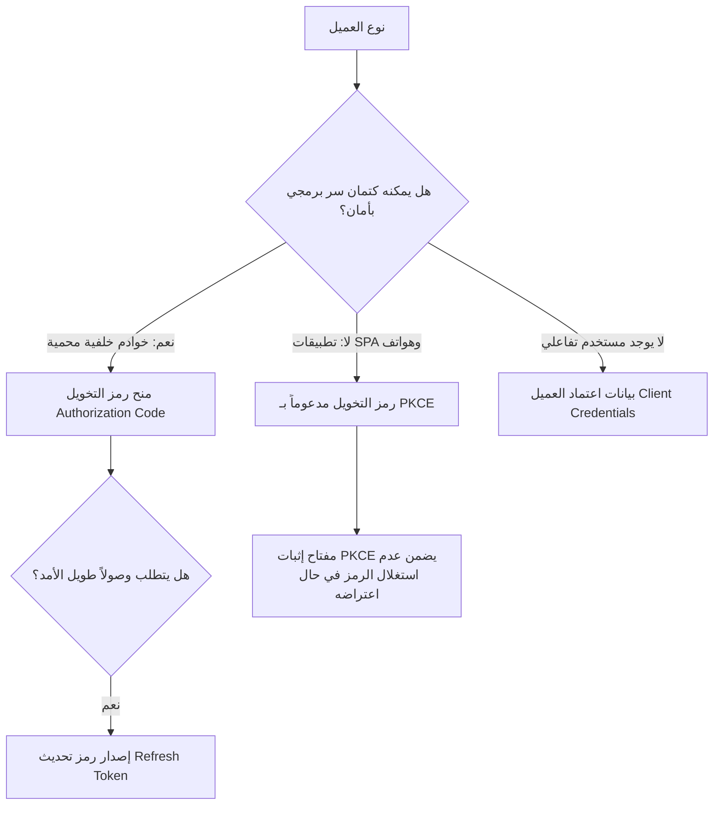
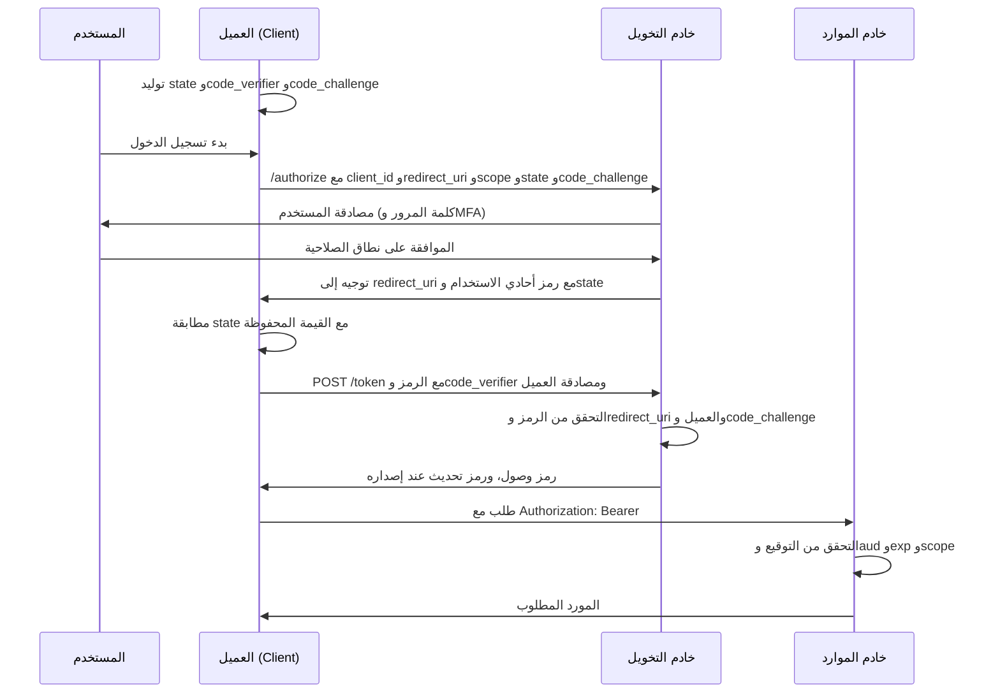

# إطار عمل OAuth 2.0

يُعد OAuth 2.0 إطار عمل التخويل (Authorization Framework) المعياري الذي يسمح لتطبيق ما بالحصول على وصول محدود ومقيد إلى بيانات المستخدم المخزنة لدى خدمة أخرى، دون أن يضطر المستخدم لمشاركة كلمة مروره مع هذا التطبيق. **OAuth 2.0 ليس بروتوكول مصادقة (Authentication Protocol)**: فهو يُصدر *رموز وصول (Access Tokens)* تثبت صلاحية تفويض محددة، ولا يمثل دليلاً على إثبات هوية المستخدم. وتتولى طبقة [OpenID Connect (OIDC)](04-oidc.md) المبنية فوقه مهمة إثبات الهوية.

## أطراف وأدوار إطار العمل

| الدور (Role) | الوصف الهندسي |
|---|---|
| **مالك المورد (Resource Owner)** | المستخدم الذي يملك البيانات ولديه صلاحية تفويض الوصول إليها. |
| **العميل (Client)** | التطبيق الذي يطلب الوصول إلى بيانات المورد نيابة عن المستخدم. |
| **خادم التخويل (Authorization Server)** | الخادم المسؤول عن مصادقة المستخدم وإصدار الرموز الأمنية (يمثل خدمة إصدار الرموز لدى مزود الهوية IdP). |
| **خادم الموارد (Resource Server)** | الخادم الذي يستضيف البيانات المحمية (مثل APIs)، ويتولى التحقق من صحة رمز الوصول قبل تنفيذ العمليات. |

يرتكز الإطار على مبدأ هندسي حاسم: لا يرى العميل كلمة مرور المستخدم إطلاقاً. بل يحصل بدلاً من ذلك على رمز وصول يحمل **نطاق صلاحية (Scope)**: وهو حزمة محددة بدقة من الصلاحيات (مثل `read:calendar` أو `write:reports`). ويحدد نطاق الصلاحية إلى جانب موافقة المستخدم الصريحة (User Consent) الحدود الدقيقة لما يمكن للرمز تنفيذه.

## أنواع منح الصلاحية (Grant Types)

تتطلب الأنواع المختلفة من التطبيقات آليات متباينة للحصول على الرمز. ويتحدد نوع المنح وفقاً لقدرة العميل على حماية الأسرار وموقع تنفيذ التعليمات البرمجية:

*اختيار نوع المنح: تتحدد مسارات التدفق بناءً على قدرة العميل على حفظ الأسرار البرمجية، ووجود تفاعل بشري مباشر، وحاجة التطبيق للوصول دون اتصال.*

- **منح رمز التخويل (Authorization Code Grant):** يُسجل المستخدم دخوله لدى خادم التخويل، فيُعيد الخادم رمزاً مؤقتاً قصير العمر (Code) إلى رابط التوجيه (`redirect_uri`). يقوم التطبيق بتبادل هذا الرمز (مرفقاً بسره الخاص `client_secret`) عبر خادمه الخلفي للحصول على الرموز الأمنية. يُعد هذا المسار العمود الفقري لمعظم تكاملات الويب.
- **رمز التخويل مع مفتاح إثبات تبادل الرموز (Authorization Code + PKCE):** المسار ذاته مع إضافة مفتاح إثبات تشفيري: يُنشئ العميل سراً عشوائياً (`code_verifier`)، ويُرسل قيمته المجزأة (`code_challenge`) عند بدء الطلب، ثم يُثبت ملكيته للسّر الأصلي عند تبادل الرمز. تجعل هذه الآلية الرمز غير قابل للاستخدام إطلاقاً في حال اعتراضه من قبل تطبيقات أخرى على جهاز المستخدم. أصبح PKCE معياراً إلزامياً لكافة أنواع التطبيقات وليس فقط للتطبيقات العامة.
- **بيانات اعتماد العميل (Client Credentials):** مخصص للتواصل الآلي المباشر بين الخوادم (Machine-to-Machine): يقوم العميل بالمصادقة باستخدام سره الخاص (أو شهادة mTLS) ويحصل على رمز وصول مقيد بصلاحيات التطبيق الذاتية دون تدخل أي مستخدم.
- **مسار تخويل الأجهزة (Device Authorization Flow):** مخصص للشاشات الذكية، أجهزة إنترنت الأشياء (IoT)، وأدوات سطر الأوامر (CLI): حيث يُمنح المستخدم رمزاً قصيراً ليقوم بإدخاله وتخويله عبر متصفح جهاز آخر.

### مسار رمز التخويل من البداية إلى النهاية

يوضح المخطط السابق نوع المنح الذي يختاره العميل. أما المخطط التسلسلي التالي فيبيّن ما يتبادله المسار الأساسي فعلياً، مع إدراج PKCE لأن كل العملاء أصبحوا مطالبين به:

*مسار رمز التخويل مدعوماً بـ PKCE. يصادق المستخدم لدى خادم التخويل وحده، والرمز أحادي الاستخدام ولا قيمة له دون code_verifier، ورمز الوصول مقيّد بخادم موارد واحد.*

لكل خطوة ضابط أمني. يربط `state` الاستجابة بجلسة المتصفح الحالية، فلا يستطيع المهاجم حقن رمزه في مسار الضحية. ويجب أن يطابق `redirect_uri` القيمة المسجلة حرفياً، لأن المطابقة الجزئية أو الرمز الشامل يحوّلان الرمز إلى هدية. والرمز قصير العمر وأحادي الاستخدام، ونقطة الرموز تفرض إما مصادقة العميل أو إثبات `code_verifier`، فلا يستطيع طرف آخر استبدال رمز معترض. ثم يتحقق خادم الموارد من الجمهور `aud`، وهو الضابط الوحيد الذي يمنع إعادة استخدام رمز صادر لواجهة أخرى.

## أنواع الرموز ودورات حياتها الأمنية

- **رمز الوصول (Access Token):** يُقدم إلى خادم الموارد (APIs) ويكون قصير الأمد (من 5 إلى 60 دقيقة). تعتمد التطبيقات الحديثة صيغة JWT الموقعة رقمياً لتمكين خوادم الموارد من التحقق من صحة وصلاحية الرمز محلياً دون الرجوع لخادم التخويل في كل طلب.
- **رمز التحديث (Refresh Token):** طويل الأمد ويُستخدم حصرياً لدى نقطة نهاية خادم التخويل (`/token`) لتجديد رموز الوصول المنتهية. ونظراً لخطورته الفائقة، يجب تخزينه بأمان صارم وتشفير في الجانب الخلفي، وتطبيق التدوير الإلزامي (Refresh Token Rotation) مع كل استخدام.
- **نطاقات الصلاحية (Scopes):** الضابط الأساسي لحدود التخويل. يُعد إصدار رموز بنطاقات واسعة جداً أو فترات صلاحية طويلة الأجل من أكثر الأخطاء التكوينية خطورة في بيئات OAuth.

## الضوابط الأمنية الإلزامية في الإنتاج

1. **حظر تسجيل الرموز في السجلات (Never Log Tokens):** تدوين رموز الوصول أو التحديث في سجلات التطبيقات يحول نظم المراقبة إلى مخازن بيانات اعتماد مخترقة.
2. **المطابقة التامة لروابط إعادة التوجيه (Exact Redirect URI Matching):** أي تساهل في مطابقة روابط التوجيه (مثل استخدام الرموز البديلة Wildcards `*`) يتيح للمهاجم توجيه رمز التخويل إلى خوادمه وسرقته.
3. **تدوير رموز التحديث (Token Rotation):** يجب إبطال رمز التحديث القديم فور استخدامه وإصدار رمز جديد. محاولة إعادة استخدام رمز تحديث مستهلك سابقاً تُعد مؤشراً حرجاً على محاولة اختراق تستوجب إلغاء كافة رموز الجلسة فوراً.
4. **تقصير عمر رمز الوصول:** الرمز بصيغة JWT غير قابل للإلغاء الفوري قبل انتهاء مدته الزمنية دون الرجوع لقوائم إبطال مركزية؛ لذا فإن فترة صلاحية الرمز تمثل نافذة الخطر الفعلية عند تسربه.

## الفارق بين التخويل (OAuth) والدخول الموحد (SSO)

رمز وصول OAuth يُثبت فقط أن: "هذا العميل يمتلك الصلاحية X على المورد Y". ولا يُثبت إطلاقاً هوية الشخص الجالس خلف الشاشة. معاملة رمز الوصول كرمز إثبات هوية تكرار لخلل أمني شائع في التطبيقات. إدارة وتأكيد الهويات هو اختصاص بروتوكول [OpenID Connect](04-oidc.md).

## معمارية القرارات والحالات الاستثنائية

- **إلزامية PKCE لجميع التطبيقات العامة:** لم يعد PKCE خياراً إضافياً؛ إذ يحظر RFC 9700 استخدام تدفق رمز التخويل بدونه للتطبيقات التي لا تملك خادماً خلفياً خاصاً.
- **معضلة رموز التحديث في المتصفح ونمط BFF:** تخزين رموز التحديث في المتصفحات (Local Storage) يعرضها للسرقة عبر هجمات XSS. النمط المعياري لتطبيقات SPA هو نمط **Backend for Frontend (BFF)**: حيث يتولى خادم وسيط خفيف الاحتفاظ برمز التحديث وإصدار كوكيز جلسات محمية (`HttpOnly` و`SameSite=Strict`).
- **تدقيق حقل الجمهور المستهدف (`aud` Claim):** رمز الوصول المصدر للواجهة البرمجية A يمكن تقديمه للواجهة B إذا لم تفحص B حقل `aud` الخاص بها وترفضه.
- **تبادل الرموز المعتمد (RFC 8693 Token Exchange):** عند حاجة خدمة مصغرة لاستدعاء خدمة أخرى نيابة عن المستخدم، يُحظر تمرير رمز الوصول الأصلي لما يحمله من نطاق وجمهور مختلف؛ بل يتم تبادل الرمز عبر نقطة النهاية للحصول على رمز مخصص للخدمة التابعة مع الحفاظ على سلسلة التفويض.
- **الرموز المقيدة بالمرسل (Sender-Constrained Tokens):** الاتجاه الحديث لحماية الرموز عبر ربطها بمفتاح إثبات الملكية المباشر للعميل، مثل DPoP (Demonstrating Proof-of-Possession) أو شهادات mTLS، مما يجعل الرمز المسروق عديم الفائدة كلياً للمهاجم.

التالي: [بروتوكول OpenID Connect (OIDC)](04-oidc.md)، طبقة الهوية الموحدة التي تكمل OAuth 2.0 لإثبات الهويات وتوفير رموز ID Tokens.