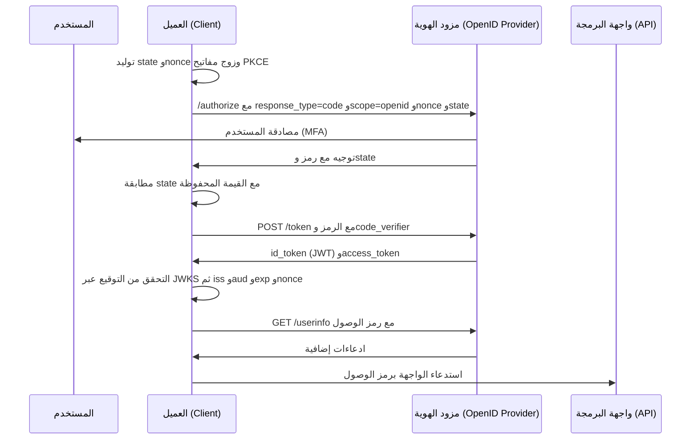

# بروتوكول OpenID Connect (OIDC)

يمثل بروتوكول OpenID Connect (OIDC) طبقة الهوية القياسية المبنية فوق إطار عمل OAuth 2.0. فبينما يختص OAuth 2.0 بنقل رموز التخويل المفوض، يضيف OIDC رمز تعريف رقمي موقع (`ID Token`) يحمل ادعاءات هوية المستخدم (Identity Claims)، إلى جانب المعايير البرمجية لاكتشاف نقاط النهاية والتحقق من صحتها آلياً. وإذا كان بروتوكول SAML يمثل المعيار المؤسسي التراثي، فإن OIDC هو المعيار الحديث الذي تعتمد عليه التطبيقات السحابية وتطبيقات الهواتف الذكية وواجهات البرمجة (APIs).

## العلاقة بين OIDC وOAuth 2.0: طبقة الهوية

العلاقة بينهما تكاملية وهرمية مقصودة: كل ما ينفذه OIDC خلال مسار تسجيل الدخول هو تدفق OAuth 2.0 اعتيادي، مضافاً إليه وثائق ومخرجات تثبت الهوية.

import Drawio from '@site/src/components/Drawio';
import oidc from '!!raw-loader!@site/static/diagrams/oidc-on-oauth.drawio';

<Drawio content={oidc} />

*بنية OIDC فوق OAuth 2.0: يُعاد استخدام إطار عمل OAuth 2.0 دون أي تعديل، وتُضاف فوقه طبقة الهوية عبر رمز ID Token، ونقطة نهاية UserInfo، ومستند الاكتشاف التلقائي Discovery. تظل الطبقة السفلى إطاراً للتخويل، بينما تظهر الهوية في الطبقة العليا.*

<a href="/diagrams/oidc-on-oauth.drawio" download>تحميل / تعديل هذا المخطط</a>

## رمز التعريف (ID Token) وبنيته التشفيرية

يُشكل رمز التعريف (ID Token) جوهر بروتوكول OIDC: وهو رمز بصيغة JSON Web Token (JWT) موقع تشفيرياً، يُصدره مزود الهوية للتطبيق العميل عند اكتمال المصادقة، ويحمل ادعاءات الهوية الموثوقة:

| الادعاء (Claim) | المعنى والهدف الأمني |
|---|---|
| `sub` | المعرف الفريد الثابت للمستخدم (Subject Identifier)، ويُحظر استخدام البريد الإلكتروني كبديل له لقابليته للتغيير. |
| `iss` | جهة الإصدار (Issuer URL)، لتحديد مزود الهوية الذي أصدر الرمز. |
| `aud` | الجمهور المستهدف (Audience)، ويجب أن يطابق تماماً معرف العميل (`client_id`) الخاص بالتطبيق. |
| `exp` / `iat` / `nbf` | نوافذ الصلاحية الزمنية (تاريخ الانتهاء، تاريخ الإصدار، وتاريخ بدء السريان). |
| `nonce` | قيمة عشوائية تمنع هجمات إعادة الإرسال (Replay Attacks)، وتربط الرمز بطلب المصادقة الأصلي الصادر من المتصفح. |
| `email`, `name`, `groups` | بيانات الهوية والسمات الوظيفية المصرح بها وفقاً لنطاق الصلاحية (`scope=openid profile email`). |

يتحقق التطبيق من التوقيع الرقمي للرمز محلياً باستخدام المفاتيح العامة لمزود الهوية (المسترجعة عبر JWKS)، ويفحص تطابق `iss` و`aud` وصلاحية `exp`، وبذلك يحصل على إثبات هوية موثوق ومفحوص دون الحاجة لإجراء اتصال شبكي ثانٍ مع مزود الهوية.

## تسلسل تسجيل الدخول

يضيف OIDC طبقة الهوية إلى مسار رمز التخويل. الرسائل نفسها التي يعرّفها OAuth، وما يتغير هو نطاق `openid`، ورمز التعريف في استجابة نقطة الرموز، وقيمة `nonce` التي تربط الرمز بهذا الطلب.



*تسجيل الدخول عبر OIDC. يحدد رمز التعريف هوية المستخدم ويتحقق منه العميل، ويحدد رمز الوصول ما يحق للعميل استدعاؤه ويتحقق منه خادم الواجهة. ولا يغني أحدهما عن الآخر.*

الفصل بين الرمزين جوهري عملياً. فخادم الواجهة الذي يقبل رمز التعريف كبيان اعتماد يحمل بذلك رمزاً صادراً لجمهور مختلف، وهو النسخة الخاصة بـ OIDC من خطأ الجمهور في OAuth. وفحص `nonce` هو ما يُفشل إعادة إرسال رمز تعريف مسروق، وجلب JWKS هو ما يسمح لمزود الهوية بتدوير مفاتيحه دون تعطيل كل العملاء دفعة واحدة.

## الاكتشاف التلقائي والتسجيل الديناميكي (Discovery & JWKS)

قضى OIDC على التعقيد التاريخي لتبادل ملفات ميتاداتا SAML عبر اعتماد مستند اكتشاف قياسي: حيث يؤدي استدعاء الرابط الموحد:

```text
https://idp.enterprise.com/.well-known/openid-configuration
```

إلى استرجاع كافة نقاط النهاية (نقاط المصادقة، الرموز، وUserInfo)، بالإضافة إلى رابط حزمة مفاتيح التوقيع الرقمي (JSON Web Key Set - JWKS):

```text
https://idp.enterprise.com/oauth2/v1/keys
```

يمكّن هذا المعيار التطبيقات من بناء الثقة بالكامل بمجرد معرفة رابط مزود الهوية، وتتم معالجة تدوير مفاتيح التوقيع بسلاسة فائقة دون انقطاع، حيث يقوم التطبيق بتحديث المفاتيح العامة من JWKS فور ظهور معرف مفتاح جديد (`kid`) في رأس الرمز.

## متى تختار SAML ومتى تعتمد OIDC؟

تنطبق المعايير المقارنة الموضحة في [توثيق SAML](02-saml.md)، مع قاعدة ذهبية: في الأنظمة الحديثة والتطبيقات السحابية وواجهات APIs وتطبيقات الهواتف، يُعتمد OIDC كخيار أول وبديهي لخفته وسهولة دمجه. بينما يُستخدم SAML مع تطبيقات SaaS التراثية أو البيئات الحكومية والتعليمية التي تفرض بنية XML. ويدعم مزود الهوية الحديث كلا البروتوكولين بالتوازي دون أي تعارض، كما توضح [المعمارية المتكاملة لإدارة الهوية](07-iam-architecture.md).

## تطبيقات OIDC في البيئات الواقعية

يتجلى دور OIDC في أربعة محاور تشغيلية أساسية:
1. تسجيل دخول المستخدمين إلى تطبيقات الويب والهواتف (عبر Authorization Code مع PKCE).
2. تأمين استدعاء واجهات البرمجة APIs عبر رموز وصول مشفرة ومقيدة بالجمهور.
3. مصادقة الأنظمة والخوادم وحسابات الخدمة (عبر Client Credentials Grant).
4. البديل السحابي الحديث لعمليات الربط التقليدية ببروتوكول LDAP القديم.

التالي: [بروتوكول SCIM](05-scim.md)، البروتوكول المخصص لأتمتة إنشاء وحذف ومزامنة حسابات المستخدمين عبر التطبيقات.