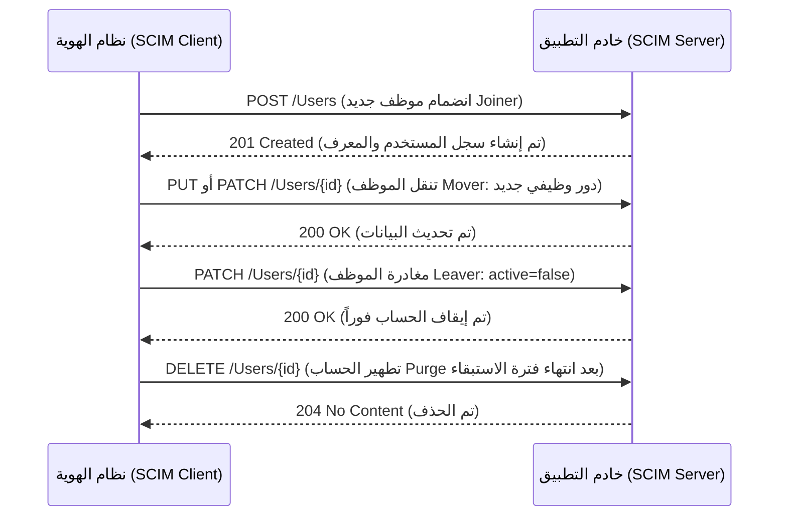

# بروتوكول SCIM 2.0

يُعد نظام إدارة الهوية عبر النطاقات (System for Cross-domain Identity Management - SCIM) المعيار المفتوح لأتمتة **تزويد وإلغاء تزويد الحسابات (Automated Provisioning & Deprovisioning)**: وهو البروتوكول المسؤول عن إنشاء، تحديث، وتعطيل حسابات المستخدمين في التطبيقات السحابية والمحلية آلياً وفورياً، عوضاً عن التدخل البشري اليدوي عبر لوحات التحكم الإدارية. وكل مبدأ أتمتة نوقش في [دورة حياة الهوية](../fundamentals/03-identity-lifecycle.md) يترجم تقنياً عبر SCIM، فهو القناة التنفيذية التي تنقل أحداث انضمام، تنقل، ومغادرة الموظفين (JML) إلى التطبيقات والأنظمة المستهدفة.

## لماذا نحتاج إلى بروتوكول موحد للتزويد؟

في غياب SCIM، يتطلب ربط كل تطبيق برمجة موصل مخصص (Custom Connector) لكل واجهة تطبيق، ومع تزايد تطبيقات المنشأة تتراكم الموصلات وتتعطل تدريجياً نتيجة تحديثات البرمجيات وتغير صيغ البيانات. بفضل SCIM، يتيح التطبيق المستهدف واجهة REST API قياسية متوافقة مع مواصفات IETF (RFC 7643 وRFC 7644)، ويتحدث نظام الهوية المركزي بروتوكولاً موحداً واحداً مع كافة التطبيقات التي تدعمه.

## نموذج العمل ومسار العمليات البرمجية

يعتمد SCIM على معمارية REST API بتبادل كائنات JSON مهيكلة وفق مخططات موحدة (Schemas). ويمثل كائن المستخدم (`/Users`) المورد الرئيسي، ترافقه كائنات المجموعات (`/Groups`) والأدوار.

*ترجمة أحداث دورة حياة الهوية إلى استدعاءات CRUD قياسية: إنشاء عند الانضمام، تحديث عند تغيير القسم أو المسمى، تعطيل فوري عند المغادرة، وحذف نهائي عند انتهاء فترة الامتثال القانوني. وتُعد اللاتكرارية (Idempotency) شرطاً أساسياً لضمان سلامة العمليات عند إعادة المحاولة.*

## العمليات التقنية وأثرها في حوكمة الهوية (IAM)

| العملية البرمجية | حدث دورة الحياة | الأثر التشغيلي والضوابط الأمنية |
|---|---|---|
| `POST /Users` | انضمام موظف (Joiner) | إنشاء الحساب آلياً بالاعتماد على `userName` و`externalId` الموحد للمنع التكرار. |
| `PUT` / `PATCH /Users/{id}` | تنقل وظيفي (Mover) | يُفضل استخدام `PATCH` للتحديث الجزئي (مثل تعديل المسمى أو المجموعات) دون الكتابة فوق كامل بيانات المستخدم. |
| `PATCH` مع `active=false` | مغادرة الموظف (Leaver) | **التعطيل الفوري دون حذف فيزيائي**: يظل الحساب موجوداً لأغراض التدقيق وسجلات المراقبة، مع سلب قدرته على تسجيل الدخول. |
| `DELETE /Users/{id}` | التطهير النهائي (Purge) | يُنفذ بعد انقضاء المهلة القانونية للاستبقاء؛ ويؤدي إلى حذف الكائن وإلغاء ارتباطه بالمجموعات. |
| `GET /Groups`, `PATCH /Groups` | مزامنة المجموعات | تنقل عضوية المجموعات إلى التطبيقات لتحديد مستويات الصلاحية والأدوار الوظيفية داخل التطبيق. |

يرتكز التصميم على خاصيتين حاسمتين لضمان استقرار الإنتاج: **اللاتكرارية (Idempotency)** (إعادة إرسال طلب الإنشاء عند انقطاع الشبكة لا يؤدي إلى تكرار الحساب)، و**المعرف الخارجي (`externalId`)** (ربط سجل التطبيق بالمعرف الأساسي في نظام الموارد البشرية HRIS لمنع انفصال السجلات عند إعادة المزامنة).

## التحديات والمزالق الشائعة في مشاريع SCIM

1. **التطبيق الجزئي للمخطط (Partial Schema Coverage):** تدعم غالبية التطبيقات مجموعة فرعية فقط من سمات SCIM القياسية. يجب توثيق "جدول تخطيط السمات" بدقة، لتجنب فشل المزامنة عند إضافة حقول جديدة من نظام الموارد البشرية.
2. **ارتباط مزامنة السمات بقرارات التخويل:** إذا فشلت مزامنة سمة القسم (`department`) أو عضوية المجموعة، يتخذ التطبيق قرارات التخويل بناءً على بيانات قديمة وغير دقيقة؛ لذا تُعد صحة واستقرار مزامنة SCIM ضابطاً أمنياً مباشراً للتحكم في الوصول وليست مجرد مسألة تكامل تقني.
3. **التزويد الأولي وحجم البيانات (Pagination & Bulk):** يتطلب التزويد الأولي للمؤسسات الكبرى استعلامات مجمعة مقسمة إلى صفحات (`Pagination`)؛ وضعف دعم التقسيم في الخادم المستهدف يُعد من أبرز أسباب تعطل مشاريع الإطلاق.
4. **حلقات المزامنة الدائرية (Sync Loops):** عند وجود مسارات تغذية متبادلة دون وجود معرف موحد صارم، قد تدخل الأنظمة في حلقات مزامنة لا نهائية. القاعدة الصارمة: **مصدر موثوق ومعتمد واحد (Single Authoritative Source) لكل سمة**.

## موقع SCIM ضمن منظومة IAM المتكاملة

يمثل SCIM جانب **الكتابة والتعديل (Write Side)** في منظومة الهوية، ليكمل جانب **القراءة والاستعلام (Read Side)** المتمثل في LDAP، وجانب **المصادقة والدخول (Login Side)** المتمثل في SAML وOIDC. تكتمل معمارية تكامل أي تطبيق عندما تتوافر فيه القدرات الثلاث: *القراءة*، *تسجيل الدخول*، و*التزويد الآلي عبر SCIM*. وتلك الثلاثية هي المعيار المعتمد لتقييم أي خدمة سحابية جديدة، كما هو موضح في [المعمارية المتكاملة لإدارة الهوية](07-iam-architecture.md).

التالي: [حوكمة وإدارة الهوية (IGA)](06-iga.md)، المنظومة الإدارية العليا التي تقرر وتتحكم في ماذا وكيف يجب أن يزود بروتوكول SCIM تلك الحسابات.