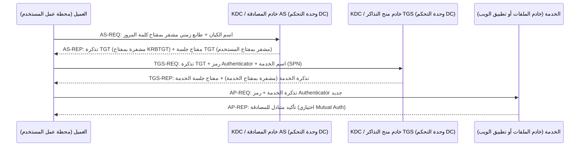

<!-- verified 2026-08-19 -->

# بروتوكول Kerberos والمصادقة في بيئات Windows

يُعد Active Directory مستودع الهويات الأكثر انتشاراً في البيئات المؤسسية، والبروتوكول الفعلي المسؤول عن مصادقة المستخدمين داخل نطاق AD هو **كيربيروس (Kerberos v5)** وليس LDAP. يُستخدم LDAP لـ *قراءة* بيانات الدليل (انظر: [بروتوكول LDAP](01-ldap.md))؛ بينما كيربيروس هو البروتوكول التشفيري الذي يُثبت من خلاله المستخدم هويته للخدمات والأنظمة دون إرسال كلمة المرور عبر الشبكة إطلاقاً. يمثل فهم آلية تبادل التذاكر المدخل الأساسي لاستيعاب الدخول الموحد في Windows، وإدراك الأسباب الجذرية لهجمات خطيرة مثل Kerberoasting والتذكرة الذهبية (Golden Ticket).

## المكونات والجهات الفاعلة

- **الكيان الرئيسي (Principal):** هوية معرّفة داخل نطاق كيربيروس، إما مستخدم بشري (`alice@CORP.LOCAL`) أو خدمة برمجية (`HTTP/web01.corp.local`). يمتلك كل كيان مفتاحاً سرياً مشتقاً من كلمة مروره.
- **مركز توزيع المفاتيح (Key Distribution Center - KDC):** الخدمة المسؤولة عن إصدار التذاكر المشفرة. في Active Directory، يعمل KDC على كل وحدة تحكم في النطاق (Domain Controller - DC) عبر منفذ 88 (UDP وTCP).
- **حساب KRBTGT:** الحساب المركزي في النطاق الذي يُستخدم مفتاحه المشتق لتشفير كافة تذاكر منح التذاكر (TGTs). يمثل تجزئة كلمة مرور هذا الحساب الجوهرة التاجية للنطاق بالكامل.
- **تذكرة منح التذاكر (Ticket-Granting Ticket - TGT):** إثبات موثوق وموقع بأن المستخدم أتم مصادقته لدى النطاق بنجاح، مشفرة بمفتاح حساب `krbtgt`، وصالحة افتراضياً لمدة 10 ساعات في Active Directory.
- **تذكرة الخدمة (Service Ticket - ST / TGS Ticket):** تذكرة تشفيرية تثبت أن المستخدم مخول بمخاطبة خدمة محددة، وتكون مشفرة بالمفتاح السري لتلك الخدمة.
- **رمز إثبات الحيازة (Authenticator):** طابع زمني قصير الأمد مشفر بمفتاح الجلسة المشترك، يثبت أن مقدم التذكرة يمتلك بالفعل مفتاح الجلسة في اللحظة الراهنة لمنع هجمات إعادة الإرسال.

## مسار تبادل التذاكر (The Ticket Exchange)

يتكون المسار من أربع رسائل موزعة على ثلاث مراحل رئيسية: طلب TGT من خدمة AS، ثم طلب تذكرة خدمة من TGS، ثم تقديم تذكرة الخدمة للخدمة المستهدفة:

*مسار كيربيروس: يثبت المستخدم معرفته بكلمة المرور لمرة واحدة فقط (مرحلة AS)، ويضمن KDC هويته لبقية اليوم عبر تذكرة TGT، وتثق كل خدمة بتوقيع KDC على التذكرة الموجهة إليها. لا يرى الخادم المستهدف كلمة مرور المستخدم نهائياً.*

ضوابط تشغيلية حاسمة:
- **انحراف التوقيت الزمني (Clock Skew):** تحمل التذاكر أختاماً زمنية دقيقة؛ لذا يجب ألا يتجاوز فارق التوقيت بين الأجهزة ووحدة التحكم 5 دقائق افتراضياً في AD. خطأ "Kerberos time skew" هو مشكلة مزامنة NTP في البنية التحتية.
- **تجديد التذاكر:** عند اقتراب انتهاء صلاحية TGT، يُكرر النظام في الخلفية طلب AS باستخدام تجزئة كلمة المرور المخزنة في الذاكرة دون إزعاج المستخدم.

## بروتوكول NTLM: مسار الرجوع التراثي ومخاطره

بروتوكول NTLM هو نظام المصادقة القديم في Windows الذي يظل مفعلاً كمسار احتياطي للحالات القديمة ومجموعات العمل (Workgroups). وهو يعاني من عيبين هيكليين خطيرين:
1. **انعدام المصادقة المتبادلة (No Mutual Authentication):** يُثبت العميل معرفته بتجزئة NT للخادم، لكن الخادم لا يُثبت هويته للعميل تشفيرياً، مما يمكن المهاجم من تشغيل خادم وهمي واصطياد مصادقات NTLM.
2. **هجمات تمرير التجزئة (Pass-the-Hash):** يرتكز البروتوكول كلياً على تجزئة NT Hash وليس على كلمة المرور الصريحة. أي مهاجم يستخلص التجزئة من ذاكرة LSASS يمكنه انتحال شخصية المستخدم مباشرة دون الحاجة لفك التشفير.

تسعى المنشآت المتقدمة إلى تعطيل NTLM نهائياً عبر سياسات المجموعة (Group Policy) والاعتماد الحصري على Kerberos.

## آليات التفويض (Delegation)

يتيح التفويض للخدمة (مثل خادم الويب) التصرف نيابة عن المستخدم عند طلب بيانات من خدمة أخرى (مثل خادم قواعد البيانات):
- **التفويض غير المقيد (Unconstrained Delegation):** تتلقى الخدمة تذكرة TGT الكاملة للمستخدم، مما يمكنها من انتحال هويته أمام أي خدمة في النطاق. يمثل خطورة بالغة؛ فاختراق هذا الخادم يمنح المهاجم تذاكر TGT لكافة المسؤولين الذين اتصلوا به.
- **التفويض المقيد (Constrained Delegation):** يُقيد قدرة الخدمة على انتحال هوية المستخدم أمام أسماء خدمات محددة فقط (SPNs)، مما يحد من دائرة الخطر.
- **التفويض المقيد القائم على المورد (RBCD):** تُحدد الخدمة المستهدفة بنفسها الكيانات المصرح لها بالتفويض إليها، مما يضع التحكم في يد مالك المورد.

## مصفوفة هجمات كيربيروس وسبل الدفاع الهندسي

| الهجوم | آلية التنفيذ | سبب النجاح | استراتيجية الدفاع الهندسي |
|---|---|---|---|
| **Kerberoasting** | طلب تذكرة خدمة لحساب خدمة مرتبط بـ SPN، ثم سحب التذكرة وتخمين كلمة المرور دون اتصال (Offline Cracking). | استخدام كلمات مرور بشرية ضعيفة لحسابات الخدمات وعدم تدويرها. | فرض كلمات مرور معقدة جداً (+25 حرفاً)، أتمتة التدوير عبر PAM/gMSA، وإلزام استخدام تشفير AES وحظر RC4. |
| **التذكرة الذهبية (Golden Ticket)** | تزوير تذكرة TGT كاملة الصلاحيات باستخدام تجزئة حساب `krbtgt` المخترق. | مفتاح `krbtgt` ثابت ولا يتغير تلقائياً، ووحدات التحكم تثق بأي تذكرة مشفرة به. | حماية وحدات التحكم كفئة Tier 0، تدوير كلمة مرور `krbtgt` مرتين دورياً وعند الاشتباه، ومراقبة تذاكر TGT الشاذة. |
| **التذكرة الفضية (Silver Ticket)** | تزوير تذكرة خدمة محددة باستخدام تجزئة الحساب المشغل لتلك الخدمة. | تذاكر الخدمات موقعة بمفتاح الخدمة ولا يتحقق الخادم من KDC في كل طلب. | حوكمة حسابات الخدمات، تدوير مفاتيحها آلياً عبر أنظمة PAM، ومراقبة حركة تذاكر AP-REQ. |
| **تمرير التجزئة (Pass-the-Hash)** | المصادقة كالمستخدم بالاعتماد على تجزئة NT Hash المستخلصة من الذاكرة عبر NTLM. | قبول NTLM للتجزئة مباشرة وبقاء التجزئات في ذاكرة LSASS. | تعطيل NTLM، تفعيل حماية Credential Guard، وتقييد صلاحيات المسؤولين على محطات العمل. |
| **تمرير التذكرة (Pass-the-Ticket)** | حقن تذكرة TGT أو تذكرة خدمة مسروقة من جهاز آخر في جلسة المهاجم. | التذاكر صالحة للاستخدام من أي جهاز حتى انقضاء مدتها. | تقصير مدد صلاحية التذاكر، منع التفويض غير المقيد، ومراقبة حقن التذاكر الشاذة. |
| **هجوم DCSync** | محاكاة وحدة تحكم في النطاق واستدعاء واجهة DRSUAPI لمزامنة وسحب كافة تجزئات النطاق بما فيها `krbtgt`. | عملية المزامنة وظيفة مشروعة ومتاحة لمسؤولي النطاق (Domain Admins). | تطبيق معمارية إدارة الطبقات (Tiered Administration)، حظر جلسات المسؤولين على محطات العمل، ومراقبة الحدث 4662 مع GUID المزامنة. |
| **Overpass-the-Hash** | تحويل تجزئة NT Hash إلى تذكرة كيربيروس شرعية عبر طلب AS-REQ بتشفير RC4. | سماح البروتوكول ببدء المصادقة بتشفير RC4 بالاعتماد على التجزئة فقط. | فرض تشفير AES حصرياً في كيربيروس، تعطيل خوارزميات RC4/DES على مستوى النطاق. |

## إشارات الرصد واكتشاف الهجمات في البيئات التشغيلية

- **ظهور تذاكر مشفرة بـ RC4 في بيئة تعتمد AES:** مؤشر قوي على محاولة هبوط تشفيري لتسهيل كسر تذاكر Kerberoasting دون اتصال.
- **شذوذ فترات صلاحية تذاكر TGT:** أي تذكرة TGT تتجاوز مدتها الصلاحية الافتراضية (10 ساعات) تمثل دليلاً قاطعاً على وجود تذكرة ذهبية مزورة (مراقبة الحدث 4768).
- **تعطيل المصادقة المسبقة (`UF_DONT_REQUIRE_PREAUTH`):** يتيح هذا الخيار للمهاجم طلب تذكرة AS-REP دون معرفة كلمة المرور (AS-REP Roasting). يجب حظر هذا الخيار وعزله ومراقبة الحدث 4768 المقترن به.
- **الارتفاع المفاجئ في طلبات تذاكر الخدمات (حدث 4769):** طلب مئات تذاكر الخدمة لأسماء SPNs متعددة في وقت وجيز يُعد البصمة الصريحة لأداة Kerberoasting تنفذ مسحاً شاملاً للنطاق.
- **استدعاءات DRSUAPI من أجهزة ليست وحدات تحكم:** ظهور الحدث 4662 من جهاز حاسوب مكتبي يُعد مؤشراً حرجاً على تنفيذ هجوم DCSync يستوجب عزل الجهاز فوراً.

التالي: [أنواع الحسابات ذات الامتيازات](../pam-core/02-privileged-account-types.md)، تصنيف الحسابات الحساسة وحوكمة وصول المسؤولين في المؤسسات.